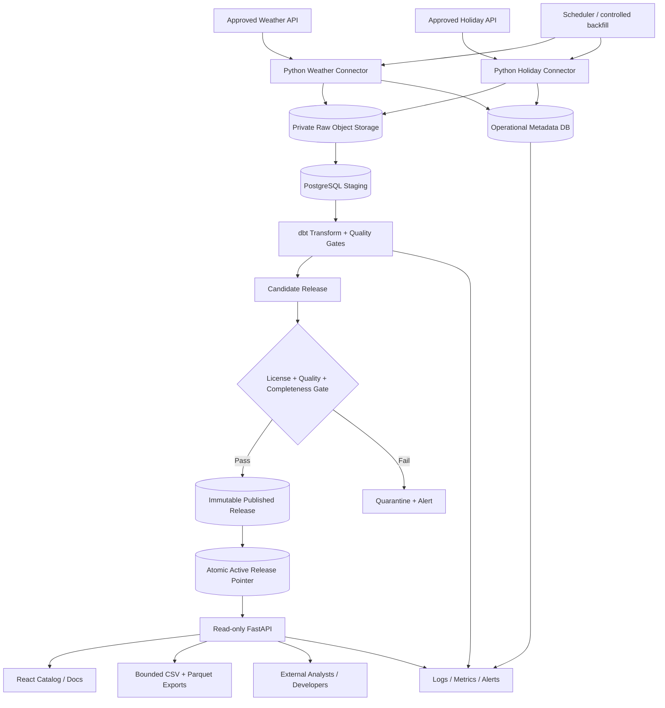

# OpenFactors — System Architecture / High-Level Design (HLD)

> **Status:** Proposed / review required  
> **Version:** 1.0  
> **Date:** 23 October 2026  
> **Author / accountable role:** Lead Data Engineer (proposed)  
> **Source of truth:** `OpenFactors_PRD_Notion_v1.md`, PRD v1.0 (23 October 2026)  
> **Release:** Philippines MVP — selected locations, historical daily weather + PH public holidays  
> **Approval:** Pending Product Owner, Engineering, Security/Privacy, Data Licensing

## 1. Purpose, authority and design principles

This HLD specifies **how** the MVP will satisfy the PRD. PRD scope and acceptance criteria take precedence. No new product promise in this document is approved without PRD change control. This is a design proposal, **not** an implemented or independently security-reviewed system.

**Design principles**
1. Preserve raw source evidence; transform deterministically; publish only validated, legally distributable outputs.
2. Make geography, time grain, units, missingness, source lineage and revisions explicit.
3. Separate ingestion/control-plane privileges from public serving privileges.
4. Prefer a small, operable MVP; avoid introducing components merely to demonstrate familiarity.
5. Ensure reruns, partial failures, backfills and revisions cannot silently corrupt published results.
6. Provide transparent limitations; external factors do not prove causal effects on business outcomes.

## 2. Scope and exclusions

**In scope:** approved weather/holiday API ingestion, source metadata, immutable raw artifacts, standardized staging, validated daily location-date mart, catalog, dictionary, filtered CSV/Parquet exports, read-only versioned API, scheduled refresh, authorized backfill, operational metrics, quality gates, provenance, public documentation, and recovery runbooks.

**Out of scope:** economic indicators (P2), global locations, causal inference, forecasts, user uploads, accounts/workspaces, paid tiers, real-time severe-weather warnings, contractual SLA. P1 example notebooks, user-facing change history and enhanced backfill experience are planned, but not required for MVP unless promoted by the Product Owner. FR-09 still requires **controlled historical backfill** as a Must: a secure maintainer-only CLI/job satisfies it without a public UI.

## 3. System context and actors

| Actor | Allowed action | Trust boundary |
|---|---|---|
| Anonymous analyst/student | Browse catalog, inspect metadata, request bounded downloads | Internet → public frontend/API |
| Developer | Read docs, query bounded paginated records | Internet → API |
| Maintainer/operator | Run/retry/backfill, inspect operational status, approve publication | Authenticated internal admin/CI environment |
| Source providers | Respond to outbound API requests | Untrusted external upstream |
| CI/CD service | Test and deploy approved changes | Repository → deployment environment |

No public user login is required in the MVP. Admin endpoints must **not** be exposed anonymously; prefer private CLI/CI jobs over building an admin API.

## 4. Architecture overview



**Logical components** (physical services may be consolidated in the MVP):
- **Connectors:** Python `httpx`/`requests` clients; source-specific parsing, rate-limit handling, retries and checkpoint metadata.
- **Raw zone:** private object storage, e.g. MinIO locally or a managed S3-compatible bucket; payload + manifest + SHA-256 digest. Object immutability is enforced by write-once keys and restricted permissions; true WORM retention is optional and requires infrastructure support.
- **Warehouse:** PostgreSQL for metadata, staging, dimensions, facts, release registry and published serving tables; separate schemas/roles.
- **Transformations:** dbt Core SQL models and tests, plus Python validation where needed.
- **Scheduler:** lightweight scheduled jobs initially (e.g. GitHub Actions/cron with concurrency controls); Airflow is an optional later ADR, not an MVP dependency.
- **Serving:** FastAPI and React/TypeScript static frontend; CDN/reverse proxy where deployed.
- **Observability:** structured logs and persisted run/quality metrics; optional Prometheus/Grafana after baseline monitoring exists.

## 5. Deployment topology and environments

```text
Internet -> HTTPS reverse proxy / CDN
                  |-> Static React site (public)
                  |-> FastAPI read-only service (public)
                            |-> PostgreSQL serving role (SELECT on published views only)

Private deployment network:
  scheduler/runner -> connector jobs -> raw object storage (private)
  transform runner -> PostgreSQL staging/curated schemas
  publisher -> release registry + active pointer (privileged)
  monitoring -> operational logs/metrics + notifications

CI/CD -> tests -> approved deployment; no production secrets in repository
```

Environments: **dev, test, and staging** are separate Docker Compose projects on this computer (`python -m ops.local_stack`). Production is not provisioned while the cost cap is USD 0. Separate credentials, buckets, databases and roles; never share a database password with the public API role.

## 6. End-to-end data lifecycle

1. **Source approval:** source registry entry records endpoint, provider, license, redistribution decision, permitted fields, attribution, coverage, quota, and reviewer/date. `license_status=approved` is required for any public release.
2. **Run creation:** scheduler creates `run_id`, source, configured locations, `[start_date, end_date]`, run mode (`incremental`/`backfill`), code version, and idempotency key.
3. **Fetch:** bounded timeout; 429 `Retry-After` respected; exponential backoff + jitter on transient 429/5xx/timeouts; no infinite retry; non-retryable 4xx/config/schema failures fail visibly.
4. **Raw capture:** save source response and a manifest (`source_id`, request parameters, retrieved_at UTC, checksum, license reference, run_id, response status, payload format). Use unique object keys and checksum-based duplicate detection. A response is not marked committed until both artifact and manifest are durable.
5. **Stage:** parse/normalize source fields, dates, units, geographic identifiers; reject invalid schema to quarantine; preserve original record identifiers when present.
6. **Model:** produce `dim_location`, `dim_date`, `fact_daily_weather`, `fact_public_holidays`, and `mart_daily_external_factors_ph` with documented local-date semantics.
7. **Validate:** schema, keys, referential integrity, numeric constraints, permitted locations, coverage, provenance, holiday semantics, and licensing. Any publish-blocking failure rejects candidate release.
8. **Publish:** create immutable versioned release; transactionally switch `active_release_id` only after full validation. Previously active release remains readable during failure.
9. **Serve:** public API and export queries are pinned to a single release ID per request; catalog metadata and dataset records use the same release pointer.
10. **Observe:** record counts, durations, failures, freshness, publication status; send alerts and provide runbook-based recovery.

## 7. Time, geography, and semantics (critical correctness decisions)

**Canonical dataset grain:** one record per (`location_id`, `date`) for `daily_external_factors_ph`. `date` is the **Philippine local calendar date** (`Asia/Manila`). Weather provider daily aggregations must be requested/configured for the same timezone; never silently convert UTC dates after aggregation. Timestamps (`retrieved_at`, `published_at`, `source_updated_at`) use UTC `TIMESTAMPTZ` and ISO 8601 externally.

**Location dimension:** stable `location_id`, label, latitude/longitude, administrative geography, timezone, effective dates, weather grid/observation metadata. Weather readings may represent model grid cells rather than municipal measurements; surface the provider's spatial resolution and limitations. Never imply weather values are exact for all businesses in a municipality.

**Holiday scope:** `is_public_holiday` means an approved **national Philippine holiday definition**, not a municipality-specific holiday, unless explicitly added in a future schema. Define treatment of regular vs special non-working days in D-03. Multiple holiday names on one date must be preserved in a normalized bridge/fact table; `holiday_name` in the public mart uses a deterministic joined representation (e.g. names sorted and separated by `;`) with the exact rule documented. Absence from a verified complete holiday calendar may map to `false`; missing/unverified holiday coverage must not be silently interpreted as `false`.

**Missing weather:** nullable numeric fields remain `null`, never `0` or fabricated values. `weather_data_status` identifies available/missing/upstream-gap; weather coverage threshold is evaluated separately from required location-date row existence. Negative precipitation is invalid; other physical range checks use documented conservative bounds. `is_weekend` derived from local date.

**Source time:** `source_updated_at` denotes the latest source update timestamp **if provided and meaningful**; otherwise nullable, with `retrieved_at` separately recorded. Do not label retrieval time as source measurement time.

## 8. Logical data model

| Entity/table | Primary or unique key | Purpose |
|---|---|---|
| `control.source_registry` | `source_id` | Provider metadata, approved redistribution status, attribution and retention |
| `control.ingestion_runs` | `run_id` | Run status, code revision, interval, counts, duration, failure category |
| `control.raw_manifests` | `artifact_id` / unique object key | Source response checksum, URI, request metadata, retrieval timestamp |
| `control.checkpoints` | (`source_id`, `location_id`, `stream`) | Last completed interval/watermark, advanced only after durable ingestion |
| `core.dim_location` | `location_id` | Stable geography and provider location mapping |
| `core.dim_date` | `date` | Local date, day of week, weekend |
| `core.fact_daily_weather` | (`location_id`, `date`, `source_revision`) | Typed weather data and source lineage |
| `core.fact_public_holidays` | (`date`, `holiday_id`, `source_revision`) | Holiday classification and names; multiple per date allowed |
| `quality.validation_runs` | `validation_run_id` | Rule results, coverage, violations, candidate release |
| `publish.dataset_releases` | `release_id` | Immutable version, schema version, row count, hash, publication metadata |
| `publish.active_dataset_release` | `dataset_id` | One current approved `release_id` per product |
| `publish.daily_external_factors_ph` | (`release_id`, `location_id`, `date`) | Immutable released rows; public-serving view filters active release |

`source_revision` is a stable source payload/retrieval revision reference; it does **not** imply the upstream supplies revision IDs. Separate `schema_version` (breaking contract) from `release_id` (content snapshot). Use a surrogate `holiday_id` stable within approved calendar policy. Exact DDL, indices and partition choices belong in the Low-Level Design (LLD).

**Mart fields required by PRD:** `date`, `location_id`, `country_code`, `temperature_mean_c`, `precipitation_mm`, `is_public_holiday`, `holiday_name`, `is_weekend`, and PRD-defined provenance/freshness fields. Before LLD signoff, reconcile the full PRD data contract field-for-field; the contract test must fail if any required field is missing or unexpectedly typed.

## 9. Publication consistency, idempotency and backfills

- **Ingestion idempotency:** deterministic source/date/location job identity; upsert checkpoint state; raw objects may be uniquely stored by `run_id` but logical records are deduplicated by business key and source revision.
- **Transformation idempotency:** deterministic dbt SQL over pinned source artifacts; repeated run with same inputs yields identical logical output. Validate output row count and checksum where deterministic serialization permits.
- **Release immutability:** insert candidate rows tagged by `release_id`; do not mutate released rows in place.
- **Atomic promotion:** database transaction checks approval flags, validation pass and release completeness, then updates active pointer; all API reads use a snapshot-consistent `release_id`. If release promotion fails, active pointer is unchanged.
- **Backfill:** maintainer-only command accepts source/location/date interval, approval or operator identity, dry-run option, resource limits, run log and quality gate. Backfill creates a new release if results change; old release retained per policy.
- **Revisions:** late source changes trigger a new content release; schema-breaking changes require `/api/v2` or a separately versioned product, migration guide, and deprecation policy.
- **Checkpoint safety:** advance watermarks only after raw persistence; publication progress is tracked separately. A failed transform never marks data as publicly refreshed.

## 10. Quality framework and publish gate

| Rule | Severity | Gate behavior |
|---|---|---|
| Required columns/types and expected units | Blocker | Reject candidate |
| Unique (`location_id`, `date`) per release | Blocker | Reject candidate |
| Valid location IDs, `PH` country, valid local dates | Blocker | Reject candidate |
| No negative precipitation; safe numeric ranges | Blocker | Reject candidate |
| Source/manifest lineage for all weather values | Blocker | Reject candidate |
| Approved license/redistribution decision for every released source | Blocker | Reject candidate |
| Required holiday calendar coverage/approved semantics | Blocker | Reject candidate |
| ≥99% expected supported location-date coverage excluding documented upstream gaps | Blocker | Reject unless formally approved exception is published |
| Extreme but plausible weather anomalies | Warning | Flag for review; do not auto-correct |
| Unusually large daily data revision | Warning/review | Manual signoff if threshold exceeded |

**Coverage denominator:** approved locations × approved dates for the advertised supported period, with documented exclusions; maintain both raw completeness and post-exclusion completeness to prevent gaming the metric. A documented upstream gap is surfaced in metadata and cannot be hidden by silently shrinking published coverage. Coverage exceptions require Product Owner approval and public disclosure.

Each candidate produces a machine-readable quality report and status `PASS`, `FAIL`, or `REVIEW_REQUIRED`. `REVIEW_REQUIRED` is not automatically publishable. All validation failures persist with samples and run references; avoid exposing raw provider payloads publicly.

## 11. Public API and export contracts

**Proposed endpoints** (same names as PRD):

| Endpoint | Behavior |
|---|---|
| `GET /api/v1/datasets` | Published catalog: coverage, grain, latest release, freshness, license summary |
| `GET /api/v1/datasets/daily-external-factors-ph` | Dictionary, units, nullable status, provenance, source/terms, limitations, release metadata |
| `GET /api/v1/factors/daily` | Filter by `location_id`, inclusive `start_date`/`end_date`, `page`, `page_size`; ordered by `date, location_id` |
| `GET /api/v1/exports/daily-external-factors-ph` | Same filters plus `format=csv|parquet`; bounded download and deterministic columns |
| `GET /openapi.json` and API docs | Machine-readable specification and examples |

**Request constraints:** exactly one approved `location_id`; dates ISO `YYYY-MM-DD`; start ≤ end; reject unsupported or excessive windows with actionable 422; unknown query parameters return 422; pagination defaults to 100 and maximum initially 1,000 records; export cap initially 100,000 rows / 50 MB (subject to load testing and ADR). A request without required filters is rejected rather than running an unbounded scan. Export requests exceeding cap return 422 with instructions to split intervals; asynchronous exports are deferred.

**Responses:** `dataset_version` (schema), `release_id` (content), `generated_at` (response timestamp), `data_as_of` (release publication/freshness reference), pagination metadata, source/license link and ordered records. `GET` queries return no mutable internal identifiers/secrets. Empty valid slices return 200 with empty `data`; unknown dataset/location returns 404; invalid query 422; rate limit 429 with `Retry-After`; temporary service unavailability 503; unexpected failures 500 with trace ID. The PRD mentions 400/422: reserve 400 for malformed request syntax and 422 for semantically invalid filters.

**Export contract:** CSV UTF-8 with header and ISO dates; Parquet with stable column types and schema metadata; filename and accompanying response headers/sidecar identify schema version, release ID, source and generated time. Sanitize text to mitigate CSV formula injection when opened in spreadsheets; holiday names are external/untrusted strings. Exports must not cross releases within a request.

**Rate limiting and caching:** public anonymous IP-based throttling with privacy-conscious log retention; CDN caching for immutable release-specific resources; active-release metadata uses short TTL or cache invalidation on promotion. Respect proxy forwarded headers only from trusted proxy networks. Public API connects with read-only DB role to published views, never raw/control schemas.

## 12. Catalog UX, documentation and accessibility

Required pages: dataset catalog; dataset detail (grain, coverage, columns/types/units/nullability, license/attribution, last successful release, known gaps, refresh status); filter/download UI; API documentation. Catalog filters: country (`PH`), configured locations, coverage dates, category. Exports show active release and generated-at time. Provide plain-language caveat: correlation is not causation.

Keyboard navigation, accessible labels, focus indicators, readable tables, responsive layouts, clear errors and progress states. For large files, indicate size and limits. No login required. P1: runnable SQL and Python notebooks, change-history page.

## 13. Security, privacy, governance and licensing

- **Secrets:** environment-specific secret store or deployment secrets; rotate credentials; never commit `.env` values.
- **Network:** TLS/HTTPS; restrict DB/object-store ingress; separate public API from private control plane.
- **Authorization:** separate connector, transformer, publisher, API read-only, CI and operator roles; least privilege; protected production deployment approvals.
- **Supply chain:** pinned dependencies, vulnerability scans, secret scanning, reviewed pull requests, minimal container images.
- **Input protection:** validate filters and use parameterized SQL; constrain exports and concurrency; API throttling; response security headers.
- **Privacy:** no user accounts or user-uploaded personal data. Operational IP addresses and access logs may still constitute personal data; define retention, access, privacy notice, and applicable Philippine privacy compliance review. Avoid persistent cross-site tracking by default.
- **Licensing:** public endpoints are disabled for any source lacking recorded redistribution permission; source-specific conditions may restrict caching, export, attribution or commercial use. Approved source policy is enforced in publication jobs, not just documentation.
- **Retention and deletion:** source-specific raw retention; version retention and backup lifecycle approved in ADR; deletion requests/terms changes require a source takedown process, including deactivating affected releases and purging public caches as required.

## 14. Reliability, SLOs and recovery

| PRD target | Design control | Measurement |
|---|---|---|
| Daily refresh attempted | Scheduled jobs with durable run records | Attempt timestamp and outcome |
| ≥99% scheduled run success (rolling 30d) | Bounded retries, incident handling, no silent skips | Successful / scheduled runs; exclude no failures without documented rule |
| ≥99% supported coverage | Coverage gate and published exceptions | Expected vs present location-date keys |
| 100% unique published key | dbt uniqueness and DB constraint | Duplicate count = 0 |
| API p95 <1s bounded cached query under defined load | Indexed serving view, caching, query limits | Load test p95 with documented concurrency and dataset size |
| Safe recovery | Last-good release, backfill/replay, backups | Recovery drill report |
| Cost control | Resource limits, budgets, storage lifecycle, egress monitoring | Monthly spend vs approved cap |

**Failure scenarios and response:**

| Failure | Detection | System behavior | Recovery |
|---|---|---|---|
| Weather API timeout/429 | Connector exception + metric | Retry boundedly; no new release on unresolved gap | Resume/retry interval; respect provider quotas |
| Upstream schema change | Contract/schema check | Quarantine payload; block candidate | Update parser + fixtures, review change, backfill |
| Holiday calendar missing/ambiguous | Coverage/semantic test | Block release or approved documented exception | Verify source authority; republish |
| Raw object write failure | Checksum/manifest verification | Fail run; do not advance checkpoint | Re-fetch or reconcile orphan artifacts |
| dbt test failure | Quality report | Preserve previous release | Fix data/model; rerun candidate |
| Publication transaction failure | DB transaction result | Roll back pointer; no partial visibility | Retry promotion after consistency check |
| Public API/database outage | Health/error metrics | Return 503 or serve cached immutable releases when safe | Restore service; verify data consistency |
| Excessive traffic/cost | Rate and cost alerts | Throttle / cap exports; preserve core service | Tune limits and cache |
| License revoked | Registry alert/manual report | Disable affected public release/access and purge caches as required | Legal review; rebuild from permitted sources |

**Backup/restore:** backup Postgres including release registry and manifests; object storage versioning/backup as appropriate; restore to isolated environment and verify referential integrity and release pointer. RPO/RTO are **not yet approved** and must be measured/accepted before public beta. At minimum, perform one restore drill before launch.

## 15. Monitoring and operations

Persist per-run: `run_id`, source, job mode, requested interval, rows fetched/staged/published, duration, attempt count, outcome, error category, code version and correlation ID. Capture validation outcomes, candidate/release IDs, freshness, upstream status, API latency/status codes, export bytes, storage consumption and approximate cost.

Alerts: scheduled run missing, repeated failure, validation blocked, freshness threshold breached, API 5xx spike, quota/cost threshold. Route to maintainer with severity and runbook URL. Initial delivery can be email/GitHub issue; production incident paging is not required for a no-SLA MVP. Avoid logging raw sensitive request metadata or API credentials.

**Runbooks required:** upstream outage, schema drift, bad data/release rollback, historical backfill, API outage, database restore, license takedown, and secret rotation. Maintain an incident log and blameless postmortem for material failures.

## 16. CI/CD and change management

Pull request gates: formatter/linter, Python unit tests, mocked source contract tests, dbt compile/tests against fixture DB, API OpenAPI/contract tests, security scans, migration checks. Staging deployment runs integration and release-gate failure simulations. Production deploy requires approval; migration is backward-compatible where possible. Breaking public schema changes use versioned API/product, changelog, and migration guidance. Production secrets remain in deployment secret store. IaC (Terraform) is optional until deployment architecture stabilizes.

**Release pipeline:** merge approved code → test → deploy staging → run sample ingestion + data tests → approve production deploy → generate candidate → validate license/quality → publish atomically → smoke test catalog/API/exports → monitor.

## 17. Requirement-to-design traceability matrix

**All PRD functional requirements:**

| PRD ID | HLD design coverage | Verification / evidence |
|---|---|---|
| FR-01 | §6 connectors, §7 weather semantics | Weather interval integration and timezone tests |
| FR-02 | §6 connectors, §7 holiday rules | Calendar fixture, duplicate-date and missing-coverage tests |
| FR-03 | §6 raw capture, §8 manifests | Artifact/checksum and manifest durability test |
| FR-04 | §7 semantics, §8 warehouse | dbt schema, unit, lineage and FK tests |
| FR-05 | §9 atomic publication, §10 gate | Inject bad candidate; active release unchanged |
| FR-06 | §11 metadata API, §12 catalog | Catalog usability and dictionary acceptance walkthrough |
| FR-07 | §11 exports | CSV/Parquet round-trip, version metadata and filter tests |
| FR-08 | §11 read-only API | OpenAPI contract, permissions, pagination/error tests |
| FR-09 | §6 schedule, §9 backfill | Scheduled run + authorized dry-run/backfill/replay test |
| FR-10 | §15 observability | Run log, alert, row-count and freshness dashboard evidence |
| FR-11 (Should) | §12 P1 examples | Execute sample SQL/Python notebooks |
| FR-12 (Won't) | §2 exclusions, §13 anonymous access | No account/workspace implementation in MVP |

**All PRD user stories:**

| PRD ID | HLD design coverage | Acceptance test |
|---|---|---|
| US-01 | §11–12 | Catalog shows geography, grain, coverage, freshness |
| US-02 | §7–8, §11–12 | Every public field has type, unit, meaning, nullable status, source |
| US-03 | §11 | Filtered CSV deterministic; invalid ranges actionable |
| US-04 | §11 | Parquet schema + release metadata round-trip |
| US-05 | §11 | API filters, paging, documented errors |
| US-06 | §5–7, §11–13 | Source, license, limitations, last successful release shown |
| US-07 | §6, §9 | Rerun same interval yields unique logical rows |
| US-08 | §10 | Publish-blocking quality failure prevents promotion |
| US-09 (P1) | §12 | Python and SQL example execute successfully |
| US-10 (P1) | §9 | Authorized backfill interval logged and rerunnable |
| US-11 (P1) | §9, §11, §16 | Version/change history and breaking change policy tested |
| US-12 (P2) | §2 exclusion | Future economic data retained at monthly grain; no MVP commitment |

**Non-functional PRD coverage:** freshness/coverage/uniqueness/reliability/latency/cost/recoverability §10, §14–15; HTTPS/least privilege §13; accessibility §12; operational visibility §15; deployment §5, §16. PRD user journeys A/B/C map to §11–12 / §11 / §6, §9–10, §14–15 respectively.

## 18. Architecture decisions and unresolved gaps

A design with unresolved external dependencies cannot honestly claim zero loopholes. These are **explicit gates**; do not treat recommended defaults as approved facts.

| Decision | Proposed direction | Blocking impact | Owner / required evidence |
|---|---|---|---|
| D-01 Pilot locations | Five cities in ADR-001: Manila, Baguio, Cebu City, Tacloban, Davao City. Provider grid mapping still empty. | Geography contract has a working baseline. The product owner confirmed the five cities on 2026-10-25. | Product + Data; `contracts/fixtures/pilot_locations.json` |
| D-02 Historical range | Start 2018-01-01 confirmed by a live ERA5 request for all five cities | Raw responses for 2018-01-01 through 2026-10-25 are stored. 2026-10-20 through 2026-10-25 are null. | `ingestion/raw/open-meteo-era5/` |
| D-03 Holiday authority and categories | Official Gazette proclamations; nationwide regular and special non-working days. Incomplete years are omitted from the release. | Holiday rows cannot be published until a year is marked complete | Source registry |
| D-04 Anonymous API vs key | Anonymous read-only, no accounts. Rate-limit numbers unset. | Abuse limits still need a later ADR | ADR-003 |
| D-05 Hosting/budget | USD 0 per month. Local Docker only. Founder / Product Lead operates failures. | Blocks any hosted production deploy | ADR-003 |
| D-06 Redistribution permissions | Open-Meteo ERA5, CC BY 4.0, non-commercial free API. Holidays transcribed from proclamations. | Commercial use of the free weather API is forbidden | Source registry |
| D-07 Scheduler | Local scheduled or manual command. Airflow is not installed. | Hosted scheduling is a later ADR | ADR-003 |
| D-08 Revision/version policy | ADR-004. New release_id for content. Keep all published releases at USD 0. Raw files kept until the source is withdrawn. No offsite copy. | Hosted expiry and any public cache still need a revised ADR | `docs/decisions/ADR-004-retention-and-withdrawal.md` |
| A-09 Backup RPO/RTO | Set after hosting choice and restore drill | Blocks operational readiness signoff | Platform; tested restore targets |
| A-10 Data retention and privacy | Source-specific retention + log retention | Blocks privacy/governance signoff | Product + Security; policies |
| A-11 API/export limits | 1,000 page size; 100k rows/50MB exports as provisional | Blocks load-test acceptance | Engineering; benchmark results |
| A-12 Full mart column contract | Reconcile PRD fields with exact DDL/types | Blocks LLD/contract-test signoff | Data; approved dictionary |
| A-13 Source availability and historical revisions | Verify real endpoints and date semantics | Blocks reliable ingestion design | Data; source fixture suite |

**Escalation rule:** any design deviation from a PRD Must or P0 requires a documented change request approved by Product Owner and Engineering Lead. Security/licensing exceptions cannot be waived by engineering alone.

## 19. Threat model and architectural review checklist

| Threat / defect | Mitigation | Verification |
|---|---|---|
| Public API reaches raw/control tables | DB role separation, views, network policy | Negative permission tests |
| SQL injection / filter abuse | Parameterized SQL, strict validation | Security test suite |
| Expensive anonymous exports | Limits, rate limiting, caching | Load/abuse simulation |
| Partial release visible | Immutable releases + atomic pointer | Forced crash during publish |
| Unapproved source redistributed | License gate in publication workflow | Inject unapproved source fixture |
| Stale cache after takedown | Cache invalidation and release deactivation | Takedown drill |
| Timezone drift / wrong joins | Local-day contract, timezone fixtures | Cross-midnight/date tests |
| Holiday duplicates or unknown coverage | Normalized fact + explicit policy | Multi-holiday and missing-source tests |
| Incorrectly claiming observed weather | Location/provider metadata and caveats | Dictionary/content review |
| Leaked credentials | Secrets management, scans, least privilege | Secret scan + access review |

## 20. Acceptance strategy and MVP go/no-go

**Engineering acceptance evidence:** (a) source approval registry and terms review; (b) raw artifact/manifest and rerun demonstration; (c) dbt quality reports and coverage calculations; (d) forced publish failure preserving last-good release; (e) working catalog, API and both export formats; (f) read-only access and abuse-control tests; (g) simulated outage + successful targeted backfill; (h) restore drill; (i) cost/load report; (j) operational dashboards and runbooks; (k) ≥3 moderated user tests per PRD DoD.

**Go** only if all P0/FR Must requirements pass, source redistribution is approved, the published dictionary matches the schema, no publish-blocking quality rule fails, required operational drills are documented, and outstanding risks are explicitly accepted by accountable owners. **No-go** if licensing is unresolved, partial release is possible, private tables are exposed, source coverage is materially misrepresented, or recovery cannot be demonstrated.

## 21. Recommended implementation sequence

1. Approve D-01/D-02/D-03/D-06; define source registry and exact data dictionary.
2. Build Python connectors + raw manifests + fixture tests and local Docker environment.
3. Create PostgreSQL core model, dbt transformations and quality checks.
4. Implement immutable releases, transactional active pointer, and failure-injection tests.
5. Build FastAPI metadata/data/export endpoints and React catalog.
6. Add scheduling, internal backfill CLI, monitoring, alerting and runbooks.
7. Complete security, privacy, load, cost, backup and licensing gates; conduct user acceptance; launch public beta.

## 22. Required follow-on artifacts

- **ADR-001:** Pilot locations — `docs/decisions/ADR-001-pilot-locations.md`
- **ADR-003:** Budget, anonymous access, and local scheduler — `docs/decisions/ADR-003-budget-and-ownership.md`
- **ADR-004:** Retention, withdrawal, and revisions — `docs/decisions/ADR-004-retention-and-withdrawal.md`
- **Source registry:** `docs/decisions/source-registry.md`
- **LLD / Physical Data Model:** DDL, indices, schema YAML, precise field contract
- **OpenAPI 3.x contract:** exact JSON payloads and error schemas
- **Data Quality Test Plan:** fixture matrices and thresholds
- **Infrastructure/Operations Runbook:** deployment, backup/restore, backfill, incident handling
- **Requirements Verification Matrix:** test IDs, owners, evidence, final pass/fail status

---

## Appendix A — PRD alignment and change control

This HLD was derived from the **actual PRD v1.0** and intentionally preserves its MVP scope, all 12 user stories, all 12 functional requirements, three user journeys, data grain, API route shapes, quality gates, and non-functional objectives. D-01 through D-08 have working baselines in `docs/decisions`. OF-005 still has to reconcile remaining contract mismatches. Provisional engineering defaults (e.g. export limits) are **not** product commitments until approved and load-tested. The PRD remains authoritative if a discrepancy is found. Document any reconciliation in an ADR/change log before implementation.

### Change history

| Version | Date | Description | Status |
|---|---|---|---|
| 1.0 | 2026-10-23 | Initial PRD-aligned architecture with traceability, failure modes and decision gates | Proposed |
