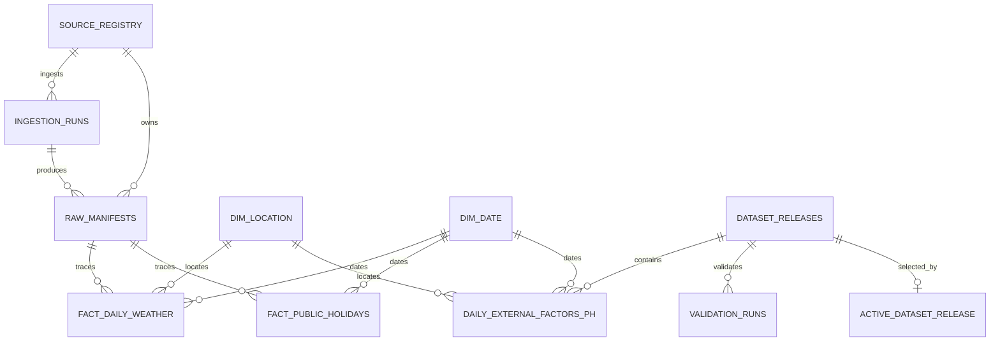

# OpenFactors — Data Models & Data Contracts (LLD)

> **Document ID:** OF-LLD-001  
> **Version:** 1.0 — proposed, review required  
> **Date:** 23 October 2026  
> **Owners:** Lead Data Engineer / Product Owner (TBD)  
> **Upstream baseline:** `OpenFactors_PRD_Notion_v1.md` v1.0; `OpenFactors_HLD_Notion_v1.md` v1.0  
> **Scope:** Philippines MVP — daily weather and national holiday factors  
> **Approval:** **NOT APPROVED**. See §17 release blockers. No claim of zero gaps before source/license, deployment, and contract verification.

## 1. Purpose, document hierarchy and change control

This LLD translates the PRD's product requirements and the HLD's architectural boundaries into implementable PostgreSQL models, source-to-target rules, data contracts, publication transactions, and executable acceptance tests. **PRD controls product scope; HLD controls system architecture; this LLD controls implementation details.** Conflicts require an ADR and approval, not silent reinterpretation.

**In scope:** `daily_external_factors_ph`; approved PH pilot locations; local-day weather; national holidays; raw artifact metadata; staged/core/release schemas; CSV/Parquet schema; quality rules; lineage; immutable releases; API-serving projections. **Out of scope:** monthly economic factors (US-12/P2), accounts (FR-12/Won't), causal inference, real-time alerts, forecasts, paid tiers. FR-09 controlled backfill remains mandatory; P1 notebooks/change-history UI are optional, but the underlying version metadata is mandatory.

### Normative language
- **MUST:** launch blocker if absent. **SHOULD:** preferred unless an approved ADR documents deviation. **MAY:** optional.
- Identifiers shown as `source_id`, `location_id`, `dataset_id`, `release_id` are stable, opaque values; public values never expose internal run IDs or object-storage keys.
- All DB timestamps are `TIMESTAMPTZ` stored as UTC instants; business dates are `DATE` interpreted in `Asia/Manila`. No floating-point for published decimal measures.

## 2. Canonical MVP data product contract (PRD §8)

**Dataset ID:** `daily_external_factors_ph`  
**Grain:** exactly one row per (`location_id`, `date`) **per immutable `release_id`**.  
**Business key within a release:** (`location_id`, `date`).  
**Geography:** approved locations in Philippines only; country `PH`.  
**Calendar:** `Asia/Manila`, inclusive dates.  
**Refresh:** daily attempted; published only after quality + license gate.  
**Versions:** `dataset_version` = semantic schema version (e.g., `1.0.0`); `release_id` = immutable content snapshot identifier, surfaced as API/export metadata, not a required row column.

| Exact PRD column | PostgreSQL type | Null? | Definition and source | Validation |
|---|---|---|---|---|
| `date` | `DATE` | No | PH local date, from `core.dim_date` | Within approved supported interval |
| `location_id` | `TEXT` | No | Stable approved `core.dim_location` ID | FK and approved-location check |
| `country_code` | `CHAR(2)` | No | `core.dim_location.country_code` | Exactly `PH` in MVP |
| `temperature_mean_c` | `NUMERIC(7,3)` | Yes | Source daily mean in Celsius, no imputation | Conservative plausible bounds configured and documented |
| `precipitation_mm` | `NUMERIC(10,3)` | Yes | Daily precipitation in millimeters | `>= 0` when nonnull |
| `is_public_holiday` | `BOOLEAN` | No | True if ≥1 approved national PH holiday; false only for **verified complete** calendar | Complete calendar prerequisite |
| `holiday_name` | `TEXT` | Yes | Names joined with ` \| ` in alphabetical order | Null when `is_public_holiday` is false |
| `is_weekend` | `BOOLEAN` | No | Sat/Sun based on PH local `date` | Recomputed date parity test |
| `weather_source_id` | `TEXT` | No | Approved weather provider for location/date even when measure unavailable | Registry FK; licensed for public use |
| `holiday_source_id` | `TEXT` | No | Approved calendar provider covering date | Registry FK; licensed for public use |
| `source_updated_at` | `TIMESTAMPTZ` | Yes | Latest meaningful upstream-provided update timestamp among contributing records | **Never substitute retrieval time** |
| `dataset_version` | `TEXT` | No | Semantic schema version copied from release | Exact match with release schema version |

**Important HLD extensions, not substitutes for PRD fields:** `release_id` (internal row key and public response metadata), `weather_data_status` (internal or additional metadata), `retrieved_at` (internal lineage), `data_as_of` (release metadata). Adding public fields requires an approved additive schema change and dictionary update. **All 12 PRD columns MUST be present**, with the names/types/nullability above. `source_updated_at` is nullable because some providers do not publish an authoritative update timestamp.

**Missingness:** If weather is unavailable, publish `NULL` weather measures and a documented internal `weather_data_status='missing'` or `'upstream_gap'`; do not substitute zero. A reported precipitation of zero stays zero. A date in an incomplete holiday year is omitted from the release. A published `is_public_holiday=false` is allowed only for a date in a complete year. The published flag is never null.

## 3. Data model: entity relationships



`RAW_MANIFESTS` to facts is logical provenance through `artifact_id`/`source_revision`. `ACTIVE_DATASET_RELEASE` stores exactly one pointer per `dataset_id`; only one approved active release is visible at a time. Historical releases are retained per approved retention policy.

## 4. Schema boundaries and access control

| Schema | Ownership / role | Contents | Public API access |
|---|---|---|---|
| `control` | ingestion/operator role | source registry, manifests, run logs, checkpoints, coverage approvals | **None** |
| `staging` | transform role | parsed, source-shaped typed inputs | **None** |
| `core` | transform role | conformed dimensions, weather/holiday facts | **None** |
| `quality` | validator role | validation runs, rule results, exceptions | **None** |
| `publish` | publisher role | immutable release records and active pointer | **SELECT only on explicitly granted safe views** |

Create separate `ingest_role`, `transform_role`, `validator_role`, `publisher_role`, and `api_reader_role`; no public database login. Revoke default schema/table privileges from `PUBLIC`; set default privileges for future objects. API accesses only safe `SECURITY INVOKER` views or approved functions with narrowly controlled execution permissions. Never grant API role direct access to raw manifests or control tables.

## 5. PostgreSQL reference DDL — control plane

The following is **implementation-grade reference DDL**, not an executed migration. Migration ordering, owner roles, and environment-specific grants belong in versioned migrations. Uses PostgreSQL 15+ and `pgcrypto` for UUID generation.

```sql
CREATE EXTENSION IF NOT EXISTS pgcrypto;
CREATE SCHEMA IF NOT EXISTS control;
CREATE SCHEMA IF NOT EXISTS staging;
CREATE SCHEMA IF NOT EXISTS core;
CREATE SCHEMA IF NOT EXISTS quality;
CREATE SCHEMA IF NOT EXISTS publish;

CREATE TABLE control.source_registry (
  source_id TEXT PRIMARY KEY,
  provider_name TEXT NOT NULL,
  source_url TEXT NOT NULL,
  source_grain TEXT NOT NULL,
  license_reference_url TEXT,
  redistribution_status TEXT NOT NULL DEFAULT 'unreviewed'
    CHECK (redistribution_status IN ('unreviewed','approved','rejected','suspended')),
  attribution_text TEXT,
  commercial_use_allowed BOOLEAN,
  retention_mode TEXT NOT NULL DEFAULT 'until_source_withdrawn'
    CHECK (retention_mode IN ('until_source_withdrawn','days')),
  raw_retention_days INTEGER,
  public_export_allowed BOOLEAN NOT NULL DEFAULT FALSE,
  approved_by TEXT,
  approved_at TIMESTAMPTZ,
  updated_at TIMESTAMPTZ NOT NULL DEFAULT now(),
  CHECK (retention_mode <> 'days' OR raw_retention_days > 0),
  CHECK (retention_mode <> 'until_source_withdrawn' OR raw_retention_days IS NULL),
  CONSTRAINT source_approval_complete CHECK (
    redistribution_status <> 'approved' OR
    (license_reference_url IS NOT NULL AND approved_by IS NOT NULL
     AND approved_at IS NOT NULL)
  )
);

CREATE TABLE control.ingestion_runs (
  run_id UUID PRIMARY KEY DEFAULT gen_random_uuid(),
  source_id TEXT NOT NULL REFERENCES control.source_registry(source_id),
  stream TEXT NOT NULL,
  location_id TEXT, -- NULL for national holiday calendar
  interval_start DATE NOT NULL,
  interval_end DATE NOT NULL,
  code_revision TEXT NOT NULL,
  status TEXT NOT NULL CHECK (status IN ('pending','running','succeeded','failed','cancelled')),
  rows_received BIGINT NOT NULL DEFAULT 0 CHECK (rows_received >= 0),
  rows_accepted BIGINT NOT NULL DEFAULT 0 CHECK (rows_accepted >= 0),
  error_category TEXT,
  started_at TIMESTAMPTZ,
  finished_at TIMESTAMPTZ,
  created_at TIMESTAMPTZ NOT NULL DEFAULT now(),
  CHECK (interval_start <= interval_end),
  CHECK (rows_accepted <= rows_received),
  CHECK (finished_at IS NULL OR started_at IS NULL OR finished_at >= started_at)
);

CREATE TABLE control.raw_manifests (
  artifact_id UUID PRIMARY KEY DEFAULT gen_random_uuid(),
  run_id UUID NOT NULL REFERENCES control.ingestion_runs(run_id),
  source_id TEXT NOT NULL REFERENCES control.source_registry(source_id),
  object_key TEXT NOT NULL UNIQUE,
  sha256_hex CHAR(64) NOT NULL CHECK (sha256_hex ~ '^[0-9a-f]{64}$'),
  content_type TEXT NOT NULL,
  request_fingerprint TEXT NOT NULL,
  retrieved_at TIMESTAMPTZ NOT NULL,
  source_updated_at TIMESTAMPTZ,
  response_status INTEGER,
  bytes_stored BIGINT NOT NULL CHECK (bytes_stored >= 0),
  retention_until TIMESTAMPTZ,
  UNIQUE (run_id, request_fingerprint)
);

CREATE TABLE control.checkpoints (
  source_id TEXT NOT NULL REFERENCES control.source_registry(source_id),
  location_id TEXT NOT NULL, -- sentinel '_national' for country calendar
  stream TEXT NOT NULL,
  last_durable_date DATE,
  updated_at TIMESTAMPTZ NOT NULL DEFAULT now(),
  PRIMARY KEY (source_id, location_id, stream)
);
```

**Implementation notes:** `object_key` points to access-controlled immutable object storage; never store credentials or sensitive request headers in `request_fingerprint`. A retry with a new `run_id` may create a new artifact; downstream logic deduplicates semantic source revisions. `checkpoints.last_durable_date` advances only after raw artifact upload **and manifest commit**, never merely after HTTP success. Add row-level locking / advisory locks to prevent concurrent checkpoint regressions. `ingestion_runs.location_id` can be FK-enforced after location migration and country-calendar handling are finalized.

## 6. PostgreSQL reference DDL — conformed dimensions and facts

```sql
CREATE TABLE core.dim_location (
  location_id TEXT PRIMARY KEY,
  display_name TEXT NOT NULL,
  country_code CHAR(2) NOT NULL CHECK (country_code = 'PH'),
  admin_region TEXT,
  admin_province TEXT,
  latitude NUMERIC(9,6) NOT NULL CHECK (latitude BETWEEN -90 AND 90),
  longitude NUMERIC(9,6) NOT NULL CHECK (longitude BETWEEN -180 AND 180),
  timezone TEXT NOT NULL DEFAULT 'Asia/Manila' CHECK (timezone = 'Asia/Manila'),
  provider_location_ref TEXT,
  weather_grid_description TEXT,
  valid_from DATE NOT NULL,
  valid_to DATE,
  approved_for_mvp BOOLEAN NOT NULL DEFAULT FALSE,
  CHECK (valid_to IS NULL OR valid_to >= valid_from)
);

CREATE TABLE core.dim_date (
  date DATE PRIMARY KEY,
  day_of_week SMALLINT NOT NULL CHECK (day_of_week BETWEEN 1 AND 7),
  is_weekend BOOLEAN NOT NULL,
  calendar_year SMALLINT NOT NULL,
  calendar_month SMALLINT NOT NULL CHECK (calendar_month BETWEEN 1 AND 12),
  CHECK (is_weekend = (day_of_week IN (6,7)))
);

CREATE TABLE core.fact_daily_weather (
  location_id TEXT NOT NULL REFERENCES core.dim_location(location_id),
  date DATE NOT NULL REFERENCES core.dim_date(date),
  source_revision TEXT NOT NULL, -- deterministic fingerprint, not necessarily upstream ID
  source_id TEXT NOT NULL REFERENCES control.source_registry(source_id),
  artifact_id UUID NOT NULL REFERENCES control.raw_manifests(artifact_id),
  temperature_mean_c NUMERIC(7,3),
  precipitation_mm NUMERIC(10,3) CHECK (precipitation_mm >= 0),
  weather_data_status TEXT NOT NULL
    CHECK (weather_data_status IN ('available','missing','upstream_gap')),
  source_updated_at TIMESTAMPTZ,
  retrieved_at TIMESTAMPTZ NOT NULL,
  PRIMARY KEY (location_id, date, source_revision),
  CHECK (weather_data_status <> 'available'
     OR (temperature_mean_c IS NOT NULL OR precipitation_mm IS NOT NULL))
);

CREATE TABLE core.fact_public_holidays (
  date DATE NOT NULL REFERENCES core.dim_date(date),
  holiday_id TEXT NOT NULL,
  source_revision TEXT NOT NULL,
  source_id TEXT NOT NULL REFERENCES control.source_registry(source_id),
  artifact_id UUID NOT NULL REFERENCES control.raw_manifests(artifact_id),
  holiday_name TEXT NOT NULL,
  holiday_category TEXT NOT NULL,
  scope TEXT NOT NULL CHECK (scope = 'national'),
  source_updated_at TIMESTAMPTZ,
  retrieved_at TIMESTAMPTZ NOT NULL,
  PRIMARY KEY (date, holiday_id, source_revision)
);

-- Required companion: verified completeness is NOT inferred from zero holiday rows.
CREATE TABLE core.holiday_calendar_coverage (
  date DATE NOT NULL REFERENCES core.dim_date(date),
  source_id TEXT NOT NULL REFERENCES control.source_registry(source_id),
  source_revision TEXT NOT NULL,
  verified_complete BOOLEAN NOT NULL DEFAULT FALSE,
  verified_at TIMESTAMPTZ,
  PRIMARY KEY (date, source_id, source_revision),
  CHECK (NOT verified_complete OR verified_at IS NOT NULL)
);

CREATE INDEX idx_weather_source_date ON core.fact_daily_weather(source_id, date);
CREATE INDEX idx_holidays_date ON core.fact_public_holidays(date);
CREATE INDEX idx_manifests_source_retrieved ON control.raw_manifests(source_id, retrieved_at DESC);
```

**Revision selection rule:** Core facts may contain multiple source revisions. A candidate release pins a manifest set / source revision cut-off, then chooses one deterministic winner for each logical key by approved revision ordering (`source_updated_at` when meaningful; otherwise `retrieved_at`, then `artifact_id` as tie-breaker). Never use nondeterministic `SELECT DISTINCT` or latest-source queries during a release. For holidays, select one coherent **calendar snapshot** for the entire covered interval, then preserve multiple holidays per date; do not mix independent per-date snapshots without documented reconciliation.

**Date validation:** `dim_date.day_of_week` uses ISO Monday=1 through Sunday=7. Generate dates from the supported interval; test against PostgreSQL `EXTRACT(ISODOW FROM date)` and `EXTRACT(YEAR/MONTH...)`. The HLD's location effective dates are modeled above; changing location coordinates or provider grid references historically requires a new effective-dated mapping table or a new `location_id` plus an ADR. Do not overwrite past geospatial meaning silently.

## 7. PostgreSQL reference DDL — validation and publication

```sql
CREATE TABLE publish.dataset_releases (
  release_id UUID PRIMARY KEY DEFAULT gen_random_uuid(),
  dataset_id TEXT NOT NULL CHECK (dataset_id = 'daily_external_factors_ph'),
  schema_version TEXT NOT NULL,
  status TEXT NOT NULL CHECK (status IN
    ('building','validating','rejected','approved','published','withdrawn')),
  source_manifest_set_hash CHAR(64) NOT NULL,
  content_sha256_hex CHAR(64),
  expected_row_count BIGINT CHECK (expected_row_count >= 0),
  actual_row_count BIGINT CHECK (actual_row_count >= 0),
  coverage_start DATE NOT NULL,
  coverage_end DATE NOT NULL,
  validated_at TIMESTAMPTZ,
  published_at TIMESTAMPTZ,
  created_at TIMESTAMPTZ NOT NULL DEFAULT now(),
  CHECK (coverage_start <= coverage_end)
);

CREATE TABLE quality.validation_runs (
  validation_run_id UUID PRIMARY KEY DEFAULT gen_random_uuid(),
  release_id UUID NOT NULL REFERENCES publish.dataset_releases(release_id),
  status TEXT NOT NULL CHECK (status IN ('running','PASS','FAIL','REVIEW_REQUIRED')),
  evaluated_at TIMESTAMPTZ NOT NULL DEFAULT now(),
  expected_location_dates BIGINT,
  present_location_dates BIGINT,
  weather_present_location_dates BIGINT,
  documented_upstream_gaps BIGINT NOT NULL DEFAULT 0,
  result_json JSONB NOT NULL DEFAULT '{}'::jsonb,
  reviewer_id TEXT,
  reviewed_at TIMESTAMPTZ
);

CREATE TABLE publish.daily_external_factors_ph (
  release_id UUID NOT NULL REFERENCES publish.dataset_releases(release_id),
  date DATE NOT NULL REFERENCES core.dim_date(date),
  location_id TEXT NOT NULL REFERENCES core.dim_location(location_id),
  country_code CHAR(2) NOT NULL CHECK (country_code = 'PH'),
  temperature_mean_c NUMERIC(7,3),
  precipitation_mm NUMERIC(10,3) CHECK (precipitation_mm >= 0),
  is_public_holiday BOOLEAN NOT NULL,
  holiday_name TEXT,
  is_weekend BOOLEAN NOT NULL,
  weather_source_id TEXT NOT NULL REFERENCES control.source_registry(source_id),
  holiday_source_id TEXT NOT NULL REFERENCES control.source_registry(source_id),
  source_updated_at TIMESTAMPTZ,
  dataset_version TEXT NOT NULL,
  weather_data_status TEXT NOT NULL CHECK (weather_data_status IN
    ('available','missing','upstream_gap')),
  PRIMARY KEY (release_id, location_id, date),
  CHECK ((is_public_holiday AND holiday_name IS NOT NULL AND length(trim(holiday_name)) > 0)
      OR (NOT is_public_holiday AND holiday_name IS NULL))
);

CREATE TABLE publish.active_dataset_release (
  dataset_id TEXT PRIMARY KEY,
  release_id UUID NOT NULL UNIQUE REFERENCES publish.dataset_releases(release_id),
  activated_at TIMESTAMPTZ NOT NULL DEFAULT now()
);

CREATE INDEX idx_published_release_date_location
  ON publish.daily_external_factors_ph(release_id, date, location_id);
```

**Integrity gaps handled in publisher code and tests:** PostgreSQL CHECK constraints cannot validate cross-table state (e.g., `dataset_version = releases.schema_version`, licensed sources, or a PASS validation). These are enforced inside the privileged publisher transaction and integration tests. In production, use a **database stored procedure with controlled `EXECUTE` privilege** or a single transaction under a restricted publisher role; prohibit arbitrary UPDATE/DELETE of published rows. For strong DB enforcement, add immutable-release triggers and a composite FK `(release_id, dataset_version)` to a unique `(release_id, schema_version)` on `dataset_releases` after migration review. This LLD requires that enforcement before public launch.

## 8. Source-to-target mapping and transformation semantics

| Output | Inputs | Deterministic transformation | Failure handling |
|---|---|---|---|
| `date` | weather daily date; holiday date | Provider request timezone set to `Asia/Manila`; align exact local `DATE` | Reject timezone mismatch |
| `location_id` | approved location mapping | Resolve via version-pinned provider grid/coordinates | Reject unmapped location |
| `country_code` | `dim_location` | Copy, enforce `PH` | Reject non-PH |
| `temperature_mean_c` | weather daily mean | Convert to Celsius only if documented source units differ | Null for missing, reject unsupported unit |
| `precipitation_mm` | weather daily precipitation | Convert to mm using explicit units | Null for missing; negative rejects |
| `is_public_holiday` | approved calendar snapshot | True if any qualifying national event; false only if calendar date verified complete | Block unverified date |
| `holiday_name` | holiday events | Trim/normalize names, deduplicate, sort by normalized name + stable ID, join ` \| ` | Reject ambiguous invalid encoding |
| `is_weekend` | local date | ISO weekday 6 or 7 | Recompute in test |
| `weather_source_id` | selected weather revision | Registry source ID | Block unapproved provider |
| `holiday_source_id` | selected calendar snapshot | Registry source ID | Block unapproved provider |
| `source_updated_at` | upstream timestamps | `GREATEST` of meaningful non-null contributing timestamps, otherwise null | Do not replace with `retrieved_at` |
| `dataset_version` | release metadata | Copy pinned `schema_version` | Block mismatch |

**Holiday policy D-03:** regular vs special non-working holiday categories and treatment of special working days **must be approved** before defining which events qualify. A generic holiday API may not be sufficient authority for legal classifications; document the authoritative source and any reconciliation process. `holiday_name` is descriptive, not proof of legal status.

**Location precision:** Weather is for a documented provider grid point or reanalysis cell; the data dictionary MUST disclose spatial/temporal resolution, model-versus-observation origin, and limitations. Do not label it an exact measurement at a business address.

## 9. dbt transformation contract and model layout

```text
warehouse/
  dbt_project.yml
  models/
    staging/
      sources.yml
      stg_weather.sql
      stg_holidays.sql
    intermediate/
      int_weather_selected_revision.sql
      int_holiday_calendar_snapshot.sql
      int_calendar_location_spine.sql
    core/
      dim_date.sql
      dim_location.sql
      fact_daily_weather.sql
      fact_public_holidays.sql
    marts/
      daily_external_factors_ph_candidate.sql
      schema.yml
  macros/
    assert_source_approved.sql
  tests/
    assert_holiday_coverage.sql
    assert_release_uniqueness.sql
    assert_source_lineage.sql
```

**Model dependency flow:** parsed `staging` → version-pinned weather/calendar selection → approved location/date spine → conformed core facts → candidate mart → quality gate → immutable published release. dbt `ref()` and `source()` MUST be used for lineage. Candidate builds run under a unique build identifier / isolated schema so parallel jobs cannot overwrite each other's candidate tables.

**Example candidate join (illustrative pseudocode; materialization and holiday snapshot pinning required):**

```sql
SELECT
  d.date,
  l.location_id,
  l.country_code,
  w.temperature_mean_c,
  w.precipitation_mm,
  (COALESCE(h.holiday_count, 0) > 0) AS is_public_holiday,
  h.holiday_name,
  d.is_weekend,
  :weather_source_id AS weather_source_id,
  :holiday_source_id AS holiday_source_id,
  CASE
    WHEN w.source_updated_at IS NULL THEN h.source_updated_at
    WHEN h.source_updated_at IS NULL THEN w.source_updated_at
    ELSE GREATEST(w.source_updated_at, h.source_updated_at)
  END AS source_updated_at,
  :schema_version AS dataset_version
FROM int_calendar_location_spine s
JOIN core.dim_date d ON d.date = s.date
JOIN core.dim_location l ON l.location_id = s.location_id
JOIN int_holiday_calendar_snapshot h ON h.date = d.date
LEFT JOIN int_weather_selected_revision w
  ON w.date = d.date AND w.location_id = l.location_id
WHERE h.verified_complete = TRUE;
```

This sketch intentionally omits the additional internal `weather_data_status` and the publisher's `release_id`; the actual dbt model MUST include both and must use pinned per-location source mappings, not a single hard-coded source parameter. The holiday intermediate MUST contain **one row for every verified date**, including dates without holidays, with `holiday_count=0` and `holiday_name=NULL`.

## 10. Data quality rules and measurable thresholds

| Rule ID | Layer | Rule | Severity | Expected evidence |
|---|---|---|---|---|
| DQ-001 | Source | Source registry approved for redistribution/export | Block | Registry + reviewer record |
| DQ-002 | Raw | Artifact checksum matches object bytes | Block | SHA-256 verification |
| DQ-003 | Stage | Required fields, parseable dates, documented units | Block | Parse/quarantine counts |
| DQ-004 | Core | FK location/date/source/artifact valid | Block | dbt relationships / SQL |
| DQ-005 | Core | Negative precipitation prohibited | Block | dbt accepted range |
| DQ-006 | Core | Source revision selected deterministically | Block | Repeat-run equality |
| DQ-007 | Holiday | Every published date has verified complete national calendar | Block | Calendar coverage anti-join |
| DQ-008 | Mart | Unique (`release_id`, `location_id`, `date`) | Block | PK + uniqueness test |
| DQ-009 | Mart | All 12 PRD columns present, exact types/nullability | Block | Information schema contract test |
| DQ-010 | Mart | Location-date row coverage ≥99% after **approved** exclusions | Block | Numerator/denominator report |
| DQ-011 | Mart | Raw coverage and excluded upstream gaps disclosed separately | Block | Quality report + catalog |
| DQ-012 | Mart | Holiday flag/name consistent; weekend matches ISO date | Block | dbt expression tests |
| DQ-013 | Release | Published rows equal approved release manifest/hash/count | Block | Recomputed checksum + count |
| DQ-014 | Release | All rows have schema version matching release | Block | Cross-table test |
| DQ-015 | API | CSV/Parquet/API values and types consistent for same release | Block | Cross-format round-trip |
| DQ-016 | Ops | Extreme but plausible weather anomalies flagged | Warning | Alert and investigation log |

**Coverage definitions:**
- `expected = approved_locations × supported_dates` less **explicitly approved and publicly disclosed exclusions**.
- `row_coverage = present_unique_location_dates / expected`; target ≥0.99. Do not exclude gaps merely to improve the denominator.
- `weather_value_coverage = location_dates_with_available_weather / expected`, published as a separate metric; null weather values are not silently considered complete weather observations.
- `calendar_coverage = verified_calendar_dates / supported_dates`; **must equal 1.00** for dates actually published.
- Missingness by metric and location MUST be published in metadata. Release review MUST inspect both pre-exclusion and post-exclusion coverage.

**Physical bounds:** For temperature, configure a conservative and source-appropriate bound (not a made-up universal meteorological truth) and record the threshold version. Only precipitation `<0` is universally blocked by the present numeric contract. Nulls remain null. Quarantined records do not silently disappear from coverage reports.

## 11. Publication protocol: transaction, immutability, snapshot consistency

1. Resolve an approved `dataset_id`, `schema_version`, pilot location set, source policy, calendar snapshot, and date interval; freeze their identifiers into a **candidate manifest**.
2. Ingest and persist immutable raw objects; verify checksum and write `raw_manifests` records. Advance ingestion checkpoint only after durable commit.
3. Build isolated candidate tables from pinned manifests; run all DQ blockers and record machine-readable `quality.validation_runs` results.
4. If any blocker fails, set release `rejected`; do **not** update active pointer. `REVIEW_REQUIRED` requires documented approval; no automatic publication.
5. Inside one PostgreSQL transaction, acquire per-dataset advisory lock; recheck approval, license status, validation status, content count/hash, complete row set, and version consistency. Mark release published and upsert active pointer. Commit atomically.
6. For each API request, read `active_dataset_release.release_id` **once** at request start; pass that pinned ID into every subsequent SQL query/export operation. If multi-query metadata/data retrieval occurs, use a consistent transaction snapshot or explicit release pin. Never re-resolve active release mid-request.
7. Cache immutable release-specific responses using `release_id`; invalidate or short-TTL the mutable active alias on promotion. License takedown must revoke access to both active and cached withdrawn releases.
8. Released rows and manifests are append-only. Corrections/backfills create a new release, never UPDATE existing content. Reversion changes the active pointer to an eligible previously approved release only after policy revalidation.

**Concurrency tests:** two simultaneous publish attempts, crash before commit, crash after candidate insert, API query during pointer switch, backfill overlapping daily run, takedown during cached export. The active release must always refer to a complete, valid, authorized snapshot.

**Operational safety note:** A release status of `published` does not automatically mean active. `active_dataset_release` is the authoritative pointer; status and active pointer transitions must be audited. A suspended source must block **new** releases and trigger a takedown decision for existing releases according to policy.

## 12. Public serving projection, API and export data contract

**Public row projection:** expose exactly the 12 PRD fields in the documented order. Internal `release_id` and `weather_data_status` can be supplied in response metadata / extended dictionary, but must not silently alter the stable v1 CSV column set. Do not expose `artifact_id`, object key, internal checksums, run IDs, or credentials.

**Endpoints (same as PRD/HLD):**

```text
GET /api/v1/datasets
GET /api/v1/datasets/daily-external-factors-ph
GET /api/v1/factors/daily?location_id=...&start_date=YYYY-MM-DD&end_date=YYYY-MM-DD&page=1&page_size=100
GET /api/v1/exports/daily-external-factors-ph?format=csv|parquet&location_id=...&start_date=...&end_date=...
GET /openapi.json
```

**API behavior:** all filters mandatory for factor and export queries; inclusive date range; `page >= 1`; default `page_size=100`, max `1000`; deterministic `ORDER BY date, location_id`; unrecognized location or dataset → 404; invalid date/window/filter → 422; malformed syntax → 400; excessive requests → 429 + `Retry-After`; unavailable dependency → 503; valid empty slice → 200 with empty data; unexpected errors → 500 + trace ID. Initial export caps: 100,000 rows and 50 MB, provisional until benchmark ADR.

**Response envelope example (illustrative):**

```json
{
  "dataset_id": "daily_external_factors_ph",
  "dataset_version": "1.0.0",
  "release_id": "00000000-0000-0000-0000-000000000001",
  "generated_at": "2026-10-23T13:00:00Z",
  "data_as_of": "2026-10-23T12:00:00Z",
  "pagination": {"page": 1, "page_size": 100, "total": 1},
  "data": [{
    "date": "2026-10-20",
    "location_id": "ph-manila",
    "country_code": "PH",
    "temperature_mean_c": 28.500,
    "precipitation_mm": null,
    "is_public_holiday": false,
    "holiday_name": null,
    "is_weekend": false,
    "weather_source_id": "open-meteo-era5",
    "holiday_source_id": "ph-official-gazette",
    "source_updated_at": null,
    "dataset_version": "1.0.0"
  }]
}
```

**Pagination consistency:** page-number pagination across active-release changes is not stable unless the client pins a `release_id`. The API MUST accept a documented immutable `release_id` query parameter or return a release-bound continuation token. For MVP choose `release_id` query parameter, include it in every response, and reject withdrawn/inaccessible releases. Without this extension, US-05 reproducibility is incomplete. The public endpoint paths remain unchanged.

**CSV:** UTF-8, header names/order identical to public projection, ISO dates and timestamps, decimal representation with dot, empty cells for null, spreadsheet formula-injection escaping on external text, plus `X-Dataset-Version`, `X-Release-Id`, `X-Data-As-Of` headers. **Parquet:** stable typed schema (`date32`, UTF-8 strings, decimal logical types, boolean, UTC timestamp), equivalent metadata in file key-value properties. Export manifest/sidecar may add provenance, source links, filters, content checksum, and record count. **License:** each public dataset page and export must expose approved provider attribution and redistribution terms.

## 13. Dataset catalog and machine-readable dictionary

Every published column MUST have `name`, `logical_type`, `physical_type`, `nullable`, `unit` (or null), `description`, `source`, `transformation`, and `examples` (synthetic if necessary). Dataset-level metadata MUST include `dataset_id`, `dataset_version`, `release_id`, `grain`, business key, timezone, geographic coverage, temporal coverage, `data_as_of`, last successful publication, next scheduled attempt, known gaps, revision policy, license and attribution, source links, provider spatial resolution, owner, quality report summary, and deprecation policy.

The catalog must distinguish **last ingestion attempt**, **last successful ingestion**, **last validated release**, and **last published release**; do not display a failed run as fresh public data. Users should be able to discover freshness without logging in (FR-12 out of scope).

## 14. Idempotency, backfill and revision management

**Ingestion:** Retry same interval with stable request fingerprint; raw files may differ by run, but core semantic keys are deterministic. Source revisions use a digest of normalized payload + source + local date/location or a provider revision ID where available. Avoid accidental revision churn from retrieval timestamps.

**Backfill command contract:** `source_id`, `location_id` (or national calendar), inclusive `start_date`, `end_date`, operator identity, `dry_run`, bounded batch size, reason, and approval reference. Log every execution. A backfill must not advance the scheduled ingestion watermark past unprocessed intervals; overlapping runs must lock or reconcile checkpoints. Changes to published data require a new release and revision note.

**Schema evolution:** additive nonbreaking changes may increment minor schema version after contract review; removals/type/semantic changes require major version and `/api/v2` or separately versioned product, migration guide, and deprecation window. `release_id` is never reused. Retention must support the published reproducibility promise or transparently state historical release expiration.

## 15. Privacy, security, licensing and retention

- No user account or personal business outcome data in MVP. Source requests, API logs, and IP addresses can still carry personal data: minimize collection, redact sensitive query parameters, define log retention, and review local privacy obligations.
- Use TLS/HTTPS, secret manager/environment injection, network segmentation, parameterized SQL, per-role grants, bounded filters, trusted-proxy configuration, and anonymous rate limits.
- Public APIs never query `control`, `staging`, `core`, `quality`, or raw object storage directly. Read only approved release projections.
- **License hard gate:** provider `redistribution_status='approved'` AND `public_export_allowed=TRUE`, with reviewer, evidence URL, attribution and source-specific retention. API accessibility is not proof of redistribution rights. License suspension or takedown triggers cache purge, active-release re-evaluation, and an auditable decision.
- Retention classes: raw artifacts, staging, core revisions, immutable releases, logs, and quality reports each require approved retention periods. Backup encryption, restore drill, RPO/RTO, and deletion/takedown procedures must be established before production release.

## 16. Verification plan, test fixtures and acceptance criteria

| Test ID | Scenario | Expected outcome |
|---|---|---|
| T-01 | Ingest same weather interval twice | No duplicate logical rows; checkpoint monotonic |
| T-02 | HTTP timeout / 429 / partial page | Bounded retries; failure logged; no false checkpoint |
| T-03 | Raw artifact tampered | Checksum fails; candidate blocked |
| T-04 | Weather source returns UTC-day aggregation | Rejected or re-requested with PH timezone |
| T-05 | Negative precipitation / unsupported units | Block candidate, quarantine with counts |
| T-06 | Missing weather values | Nulls preserved, missingness documented |
| T-07 | Holiday date with no events but verified complete | `false`, null holiday name |
| T-08 | Holiday calendar date unverified | No false negative; candidate blocked |
| T-09 | Two national holidays same day | Deterministic distinct joined names |
| T-10 | Source revision changes historical value | New immutable release, old remains reproducible |
| T-11 | DQ failure at publication | Active pointer unchanged |
| T-12 | Crash during publish transaction | Old or complete new release only |
| T-13 | Concurrent publish requests | One serialized valid pointer; no mixed content |
| T-14 | Source license not approved | Release blocked and public export denied |
| T-15 | CSV vs Parquet vs API same release | Same values/types/order semantics, documented nulls |
| T-16 | API role queries `control.raw_manifests` | Permission denied |
| T-17 | API pagination while release changes | Pinned `release_id` returns stable pages |
| T-18 | Source update timestamp absent | `source_updated_at` null, retrieved time separate |
| T-19 | Supported period includes gaps | Both coverage measures and exclusions visible |
| T-20 | API oversized export, invalid dates, unknown location | Appropriate 422/404/429; no unbounded scan |
| T-21 | Withdraw published source / cached content | No unauthorized stale release access |
| T-22 | Restore backup and replay failed job | RPO/RTO and integrity checks recorded |
| T-23 | Schema migration drops PRD field | CI contract test fails |
| T-24 | Holiday category policy changes | ADR, versioning, and affected release review |

**Test pyramid:** unit fixtures for connectors/mappings; dbt model and relationship tests; migration tests against ephemeral PostgreSQL; integration tests with MinIO + database + API; contract tests using OpenAPI and Parquet readers; release/rollback/takedown chaos drills; representative load tests for p95 <1s bounded cached API queries under documented load. PRD target of ≥99% successful scheduled runs is evaluated over rolling 30 days once production operation begins, not falsely claimed during development.

## 17. Open decisions, residual risks and launch gates

These inherit HLD §18. **No production/public redistribution until blockers are closed with evidence.**

| ID | Decision / gap | Impact on this LLD | Closure evidence |
|---|---|---|---|
| D-01 | Exact 3–5 pilot locations | `dim_location` values, coverage | Working baseline 2026-10-24 in ADR-001 and `contracts/fixtures/pilot_locations.json`. Grid mapping still empty until OF-012. Product owner confirmed the five cities on 2026-10-25. |
| D-02 | Historical date range | Date spine, backfill size, coverage | Start `2018-01-01` confirmed for Open-Meteo ERA5. Raw responses through 2026-10-25 are stored. Six trailing days are null. |
| D-03 | Holiday authority/categories | Holiday truth rules | Working baseline in the source registry. Years 2018 through 2026 are transcribed from Official Gazette proclamations. |
| D-04 | Anonymous access/key | API abuse controls | Anonymous read-only in ADR-003. Numeric rate limits still open. |
| D-05 | Hosting and cost cap | Partitioning, retention, availability | USD 0 and local Docker only, ADR-003. |
| D-06 | Weather and holiday redistribution | **Hard public release blocker** | Working baseline in `docs/decisions/source-registry.md`. Non-commercial only. |
| D-07 | Scheduler choice | Checkpoint/orchestration implementation | Local command in ADR-003. Learning Airflow is ADR-007 and is not the production scheduler. |
| D-08 | Content release retention | Reproducibility promise | Working baseline in ADR-004. `retention_mode = until_source_withdrawn` is now in the source-registry DDL. |
| A-09 | Backup RPO/RTO | Disaster recovery | No offsite copy at USD 0, stated in ADR-004. Hosted restore targets remain unset. |
| A-10 | Raw/log retention/privacy | Storage policy and compliance | Raw-file mode is in ADR-004. Log retention and privacy review remain open. |
| A-11 | Page/export limits | Public performance | Benchmarks and accepted limits |
| A-12 | Full PRD field contract | **Resolved by §2 and §7**, pending tests | Automated information-schema test passes |
| A-13 | Real API revisions/timezone | Source selection and data semantics | Real response fixtures and integration test |
| NEW-01 | `release_id` pin for pagination | Stable multi-page reads | API/OpenAPI ADR + contract test |
| NEW-02 | DB-enforced immutable releases | Prevent accidental mutation | Migration trigger/privilege tests |
| NEW-03 | Location history/grid remapping | Historical geographic consistency | Effective-dated mapping ADR |
| NEW-04 | Calendar completeness proof | Avoid false non-holiday values | Coverage verification policy + fixtures |

**Go/no-go:** PRD Must requirements satisfied; all DQ blockers passing; source redistribution permissions approved; source/location/date policies approved; complete 12-field schema contract; no partial-publication vulnerability; stable API/exports and release pinning; permissions negative tests; incident/takedown/restore drills; documented owner and budget. Any exception requires Product Owner + Engineering Lead approval; licensing/security exceptions also require appropriate governance approval.

## 18. Requirements traceability — PRD → HLD → LLD → tests

| PRD | HLD design | LLD implementation | Verification |
|---|---|---|---|
| FR-01 | §§6–7 connectors/semantics | §§5–6, 8, 14 | T-01, T-02, T-04 |
| FR-02 | §§6–7 holiday | §§6, 8, 10 | T-07–09, T-24 |
| FR-03 | §§6,8 raw/manifests | §5 raw manifests/checkpoints | T-03, T-18 |
| FR-04 | §§7–8 typed warehouse | §§2,6,8–9 | T-05, T-06, T-23 |
| FR-05 | §§9–10 publication gate | §§7,10–11 | T-11–14 |
| FR-06 | §§11–12 catalog | §§12–13 | T-18, T-19 |
| FR-07 | §11 exports | §12 CSV/Parquet | T-15, T-20 |
| FR-08 | §11 API | §§4,12,15 | T-16, T-17, T-20 |
| FR-09 | §§6,9 scheduler/backfill | §§5,11,14 | T-01, T-02, T-10 |
| FR-10 | §15 observability | §§5,10,13,16 | T-02, T-19, T-22 |
| FR-11 (Should) | §12 examples | §13 dictionary + example-ready joins | Notebook execution when P1 promoted |
| FR-12 (Won't) | §§2,13 exclusions | §§1,15 anonymous access | No account endpoints in MVP |
| US-01 | §§11–12 catalog | §13 | Catalog acceptance walkthrough |
| US-02 | §§7–8,11–12 dictionary | §§2,13 | T-23 + dictionary field audit |
| US-03 | §11 CSV | §12 | T-15, T-20 |
| US-04 | §11 Parquet | §12 | T-15 |
| US-05 | §11 API | §12 | T-17, T-20 |
| US-06 | §§11–13 provenance | §§2,13,15 | T-14, T-18–19 |
| US-07 | §§6,9 idempotency | §§5,6,14 | T-01 |
| US-08 | §10 quality gate | §§10–11 | T-03, T-11 |
| US-09 (P1) | §12 notebooks | §§9,13 | Runnable SQL/Python examples after promotion |
| US-10 (P1) | §9 backfills | §14 | T-10 + operator drill |
| US-11 (P1) | §§9,11,16 revisions | §§11–14 | T-10, T-17, T-24 |
| US-12 (P2) | §2 exclusion | §1 exclusion | No economic daily-grain fabrication |

**Traceability review result:** All 12 PRD functional requirements and all 12 user stories are mapped. This is **design coverage**, not proof of implementation correctness. Release requires actual passing tests and approved decisions.

## 19. Suggested implementation order and Definition of Done

1. **ADR & source approval:** D-01/D-02/D-03/D-06; pilot fixtures, licensing, data dictionary.
2. **Database foundation:** roles/schemas, migration tests, source registry, dimensions, manifests and ingestion runs.
3. **Connectors and raw storage:** weather and holidays, immutable raw, checkpoints, retry/backfill safety.
4. **dbt core and candidate:** deterministic revision selection, calendar completeness, typed mart.
5. **Quality and publisher:** DQ suite, candidate manifests, immutable release transaction, negative security tests.
6. **API/export/catalog:** pinned release reads, CSV/Parquet parity, metadata and attribution.
7. **Operations and launch:** alerts, CI/CD, load test, backup restore, takedown drill, go/no-go signoff.

**Definition of Done for this LLD:** reviewer approves 12-field contract, ERD, DDL migrations, roles, source-to-target rules, data quality suite, immutable publication algorithm, public projection, and traceability; all open launch-blocking decisions closed or formally deferred without violating a PRD Must. Code and deployment readiness are tracked separately.

## Appendix A — Design assumptions and implementation cautions

- This reference DDL is a baseline, not an independently executed migration; syntax, locking, grants, trigger behavior, and end-to-end integrity must be validated in CI.
- `source_updated_at` is a provider update timestamp only when meaningful, **not** retrieval or measurement timestamp.
- A valid holiday calendar needs an explicit completeness artifact even for dates with zero holiday events.
- A 99% location-date row coverage target does not imply 99% nonnull weather data; report both.
- For a small MVP, PostgreSQL indexes and whole-release snapshots may be sufficient; partitioning is a measured scaling decision, not a default requirement.
- Source attribution, redistribution, geographic resolution, and source revisions are product-facing correctness obligations, not merely internal metadata.

## Appendix B — Document control

| Artifact | Baseline | Alignment |
|---|---|---|
| PRD | v1.0, 23 Oct 2026 | Product scope, 12 FR, 12 US, 12 exact data fields |
| HLD | v1.0, 23 Oct 2026 | Logical schemas, raw→core→publish, quality gates, immutable release |
| LLD | v1.0, 23 Oct 2026 | Concrete DDL, transformations, contracts, test cases, open gates |

**Next artifacts:** migration repository + `dbt_project.yml`/`schema.yml`, machine-readable data contract (YAML/JSON Schema), OpenAPI 3.1 contract, architecture decision records, and test fixtures. Each should reference `OF-LLD-001` and preserve the PRD/HLD baseline.
