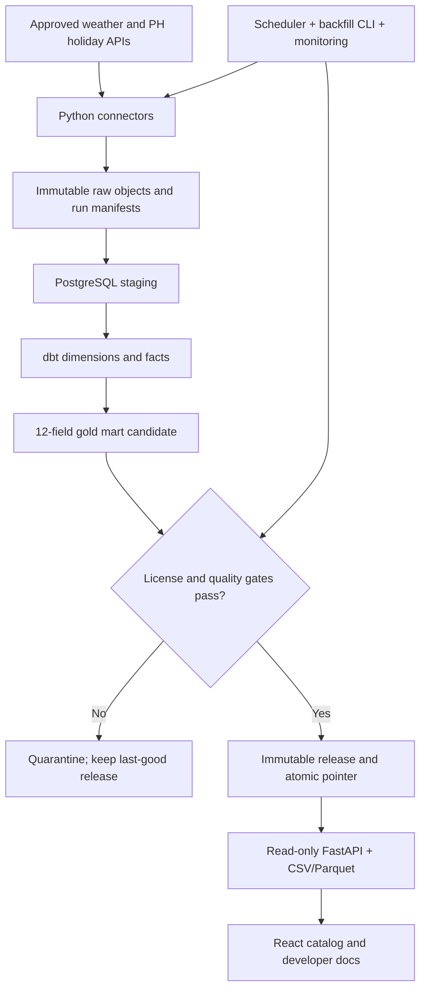

# OpenFactors — Engineering Backlog & Sprint Planning

> Version 1.0 · 2026-10-23 · Status: Draft for review · Notion-ready

## 1. Authority and document alignment

Source documents reviewed: OpenFactors PRD v1.0, HLD v1.0, Data Models & Contracts LLD v1.0, API Specification v1.0, OpenAPI 3.1 YAML. PRD controls product scope; HLD controls architecture; LLD controls data semantics; OpenAPI controls HTTP interface. Any conflict must be reconciled in an ADR and updated in all affected artifacts before implementation (OF-005).

**MVP:** FR-01–FR-10 and US-01–US-08. FR-09 requires controlled historical backfill via maintainer CLI/job even though optional backfill UI is P1. FR-11/US-09 examples and user-facing US-11 change history are P1. FR-12 accounts and US-12 economic indicators are excluded. No causal inference or forecasting.

## 2. Reference architecture

The public grain is one `(location_id, date)` row per release in `Asia/Manila`. Missing weather stays null; unknown holiday dates cannot silently become non-holidays. `dataset_version` identifies schema/semantic version, while `release_id` identifies the immutable content snapshot. Raw, staging and internal metadata are not publicly queryable.

## 3. Planning policy and staffing

S0–S9 are **dependency waves**, not promised calendar weeks. A two-week sprint cadence is optional, subject to capacity and velocity. Story points are relative estimates (3, 5, 8); they are not hours. No delivery deadline is committed until source approval lead times, team size and velocity are known. Suggested roles: Product Owner, Lead/Data Engineer, Backend Engineer, Frontend Engineer, Platform/SRE, QA/Security and source-license reviewer; one person may perform multiple technical roles.

## 4. Sprint backlog

### S0 — Governance and architecture approvals
**Tickets:** 5 · **Estimated points:** 21

| ID | Priority | Engineering task | Depends on | Points |
|---|---|---|---|---:|
| OF-001 | P0 | Approve pilot locations, stable IDs and historical date coverage | — | 3 |
| OF-002 | P0 | Approve weather and holiday source licensing and redistribution | OF-001 | 5 |
| OF-003 | P0 | Approve deployment budget, SLO load profile and operating ownership | — | 3 |
| OF-004 | P0 | Decide retention, release withdrawal and revision policy | OF-002 | 5 |
| OF-005 | P0 | Reconcile PRD/HLD/LLD/OpenAPI normative mismatches | OF-001,OF-004 | 5 |

**Exit evidence:** For every P0 ticket, attach code review/PR, test report, relevant ADR, and demo or runbook proof. A blocked upstream approval means the ticket cannot be accepted.

### S1 — Repository and platform foundations
**Tickets:** 5 · **Estimated points:** 23

| ID | Priority | Engineering task | Depends on | Points |
|---|---|---|---|---:|
| OF-006 | P0 | Set up monorepo, tooling, branch protections and code ownership | OF-003 | 3 |
| OF-007 | P0 | Provision isolated dev/test/staging PostgreSQL and object storage | OF-006 | 5 |
| OF-008 | P0 | Implement source registry and immutable run manifest schema | OF-002,OF-007 | 5 |
| OF-009 | P0 | Implement dataset contract fixtures and cross-layer schema checks | OF-005,OF-006 | 5 |
| OF-010 | P0 | Implement private/public DB roles and network boundaries | OF-007 | 5 |

**Exit evidence:** For every P0 ticket, attach code review/PR, test report, relevant ADR, and demo or runbook proof. A blocked upstream approval means the ticket cannot be accepted.

### S2 — Source ingestion and immutable raw archive
**Tickets:** 5 · **Estimated points:** 28

| ID | Priority | Engineering task | Depends on | Points |
|---|---|---|---|---:|
| OF-011 | P0 | Build resilient shared HTTP connector with retries and throttling | OF-008 | 5 |
| OF-012 | P0 | Ingest historical weather with correct local-day semantics | OF-001,OF-011 | 8 |
| OF-013 | P0 | Ingest and verify PH national holiday calendar | OF-002,OF-011 | 5 |
| OF-014 | P0 | Persist raw payload bytes and checksums atomically | OF-008,OF-011 | 5 |
| OF-015 | P0 | Implement ingestion run checkpointing and audit events | OF-011,OF-014 | 5 |

**Exit evidence:** For every P0 ticket, attach code review/PR, test report, relevant ADR, and demo or runbook proof. A blocked upstream approval means the ticket cannot be accepted.

### S3 — Warehouse and 12-field gold mart
**Tickets:** 5 · **Estimated points:** 29

| ID | Priority | Engineering task | Depends on | Points |
|---|---|---|---|---:|
| OF-016 | P0 | Create PostgreSQL dimensions and source fact migrations | OF-007,OF-009 | 5 |
| OF-017 | P0 | Build typed staging dbt models for weather and holidays | OF-012,OF-013,OF-016 | 8 |
| OF-018 | P0 | Implement canonical local-date and location dimensions | OF-001,OF-016 | 3 |
| OF-019 | P0 | Implement deterministic weather revision selection and holiday join | OF-017,OF-018 | 8 |
| OF-020 | P0 | Build 12-column gold mart and data dictionary | OF-019,OF-009 | 5 |

**Exit evidence:** For every P0 ticket, attach code review/PR, test report, relevant ADR, and demo or runbook proof. A blocked upstream approval means the ticket cannot be accepted.

### S4 — Quality gates and atomic publication
**Tickets:** 5 · **Estimated points:** 34

| ID | Priority | Engineering task | Depends on | Points |
|---|---|---|---|---:|
| OF-021 | P0 | Implement publish-blocking schema, uniqueness and FK gates | OF-020 | 5 |
| OF-022 | P0 | Implement coverage, plausibility and calendar completeness gates | OF-020,OF-001 | 8 |
| OF-023 | P0 | Build candidate release manifest and content checksums | OF-021,OF-022,OF-004 | 5 |
| OF-024 | P0 | Implement atomic release promotion and rollback | OF-023,OF-010 | 8 |
| OF-025 | P0 | Implement source withdrawal and export/cache invalidation | OF-004,OF-024 | 8 |

**Exit evidence:** For every P0 ticket, attach code review/PR, test report, relevant ADR, and demo or runbook proof. A blocked upstream approval means the ticket cannot be accepted.

### S5 — REST API and OpenAPI conformance
**Tickets:** 5 · **Estimated points:** 28

| ID | Priority | Engineering task | Depends on | Points |
|---|---|---|---|---:|
| OF-026 | P0 | Implement catalog endpoint and approved-release filtering | OF-024,OF-009 | 5 |
| OF-027 | P0 | Implement dataset dictionary endpoint and release pin | OF-020,OF-024 | 5 |
| OF-028 | P0 | Implement factor query, filters and deterministic pagination | OF-024,OF-010 | 8 |
| OF-029 | P0 | Implement unified validation and error envelope | OF-026,OF-028 | 5 |
| OF-030 | P0 | Publish and validate OpenAPI 3.1 contract | OF-005,OF-026,OF-027,OF-028,OF-029 | 5 |

**Exit evidence:** For every P0 ticket, attach code review/PR, test report, relevant ADR, and demo or runbook proof. A blocked upstream approval means the ticket cannot be accepted.

### S6 — CSV/Parquet exports
**Tickets:** 3 · **Estimated points:** 18

| ID | Priority | Engineering task | Depends on | Points |
|---|---|---|---|---:|
| OF-031 | P0 | Implement deterministic CSV export with formula safety | OF-028,OF-004 | 5 |
| OF-032 | P0 | Implement Parquet export with typed metadata | OF-028,OF-004 | 8 |
| OF-033 | P0 | Implement export quotas, bounded streaming and download headers | OF-031,OF-032,OF-003 | 5 |

**Exit evidence:** For every P0 ticket, attach code review/PR, test report, relevant ADR, and demo or runbook proof. A blocked upstream approval means the ticket cannot be accepted.

### S7 — Catalog, dictionary and developer experience
**Tickets:** 3 · **Estimated points:** 16

| ID | Priority | Engineering task | Depends on | Points |
|---|---|---|---|---:|
| OF-034 | P0 | Build catalog page with coverage, freshness and attribution | OF-026 | 5 |
| OF-035 | P0 | Build dictionary, filter and CSV/Parquet download flow | OF-027,OF-033 | 8 |
| OF-036 | P0 | Build developer API guide and example requests | OF-030 | 3 |

**Exit evidence:** For every P0 ticket, attach code review/PR, test report, relevant ADR, and demo or runbook proof. A blocked upstream approval means the ticket cannot be accepted.

### S8 — Orchestration, backfill and operations
**Tickets:** 4 · **Estimated points:** 26

| ID | Priority | Engineering task | Depends on | Points |
|---|---|---|---|---:|
| OF-037 | P0 | Implement daily orchestration with bounded retries | OF-015,OF-024 | 8 |
| OF-038 | P0 | Implement authorized historical backfill CLI/job | OF-037,OF-004 | 5 |
| OF-039 | P0 | Instrument freshness, quality, pipeline and API dashboards | OF-037,OF-028 | 5 |
| OF-040 | P0 | Create backup, restore and failed-run recovery runbooks | OF-007,OF-037 | 8 |

**Exit evidence:** For every P0 ticket, attach code review/PR, test report, relevant ADR, and demo or runbook proof. A blocked upstream approval means the ticket cannot be accepted.

### S9 — Security, performance and launch
**Tickets:** 4 · **Estimated points:** 26

| ID | Priority | Engineering task | Depends on | Points |
|---|---|---|---|---:|
| OF-041 | P0 | Run end-to-end security, permission and abuse testing | OF-025,OF-030,OF-033 | 8 |
| OF-042 | P0 | Run performance, coverage and reliability validation | OF-039,OF-033 | 8 |
| OF-043 | P0 | Execute product acceptance and go/no-go review | OF-034,OF-035,OF-036,OF-040,OF-041,OF-042 | 5 |
| OF-044 | P0 | Deploy public beta with rollback and feedback telemetry | OF-043 | 5 |

**Exit evidence:** For every P0 ticket, attach code review/PR, test report, relevant ADR, and demo or runbook proof. A blocked upstream approval means the ticket cannot be accepted.

### Post-MVP — Optional improvements
**Tickets:** 3 · **Estimated points:** 13

| ID | Priority | Engineering task | Depends on | Points |
|---|---|---|---|---:|
| OF-045 | P1 | Provide runnable Python and SQL example joins | OF-044 | 5 |
| OF-046 | P1 | Publish user-facing change history and revision guide | OF-044,OF-004 | 3 |
| OF-047 | P1 | Improve operator backfill UI beyond required CLI | OF-038 | 5 |

**Exit evidence:** For every P0 ticket, attach code review/PR, test report, relevant ADR, and demo or runbook proof. A blocked upstream approval means the ticket cannot be accepted.

### Out of scope — Explicit exclusions
**Tickets:** 2 · **Estimated points:** 0

| ID | Priority | Engineering task | Depends on | Points |
|---|---|---|---|---:|
| OF-048 | Won't | Accounts and saved workspaces | — | 0 |
| OF-049 | P2 | Monthly economic indicators | — | 0 |

**Exit evidence:** For every P0 ticket, attach code review/PR, test report, relevant ADR, and demo or runbook proof. A blocked upstream approval means the ticket cannot be accepted.

## 5. Full ticket acceptance contracts

The companion CSV is the canonical Notion task database; the details below preserve acceptance criteria and verification even if CSV property types are imported as plain text.

### OF-001 — Approve pilot locations, stable IDs and historical date coverage
- **Sprint / priority / owner role:** S0 / P0 / Data/Platform Engineer
- **Requirement links:** FR-01,FR-04,US-01
- **Dependencies:** None
- **Acceptance:** Signed location list, timezone, granularity, history and supported ranges; reflected in contract fixtures
- **Verification evidence:** ADR + fixture review
- **Gate:** BLOCKER

### OF-002 — Approve weather and holiday source licensing and redistribution
- **Sprint / priority / owner role:** S0 / P0 / Data/Platform Engineer
- **Requirement links:** FR-01,FR-02,FR-03,US-06
- **Dependencies:** OF-001
- **Acceptance:** Source-by-source reviewed terms for API, exports, cache, raw retention, attribution and takedown; no unapproved public rows
- **Verification evidence:** Source registry approval evidence
- **Gate:** BLOCKER

### OF-003 — Approve deployment budget, SLO load profile and operating ownership
- **Sprint / priority / owner role:** S0 / P0 / Data/Platform Engineer
- **Requirement links:** FR-10,US-06
- **Dependencies:** None
- **Acceptance:** Cost cap, alert thresholds, ownership, on-call coverage, load assumptions and approved environments recorded
- **Verification evidence:** ADR and owner sign-off
- **Gate:** BLOCKER

### OF-004 — Decide retention, release withdrawal and revision policy
- **Sprint / priority / owner role:** S0 / P0 / Data/Platform Engineer
- **Requirement links:** FR-03,FR-05,FR-08,US-11
- **Dependencies:** OF-002
- **Acceptance:** Raw/release retention, withdrawal, cache purge, version compatibility and legal takedown rules signed
- **Verification evidence:** ADR + tabletop
- **Gate:** BLOCKER

### OF-005 — Reconcile PRD/HLD/LLD/OpenAPI normative mismatches
- **Sprint / priority / owner role:** S0 / P0 / Data/Platform Engineer
- **Requirement links:** FR-04,FR-08,US-05
- **Dependencies:** OF-001,OF-004
- **Acceptance:** All schema nullability, endpoints, error codes, source timestamp semantics and row limits agree; changes versioned
- **Verification evidence:** Automated contract diff + review
- **Gate:** BLOCKER

### OF-006 — Set up monorepo, tooling, branch protections and code ownership
- **Sprint / priority / owner role:** S1 / P0 / Data/Platform Engineer
- **Requirement links:** FR-04,FR-08
- **Dependencies:** OF-003
- **Acceptance:** Pinned dependencies, formatting/linting, reviews, CI required checks and secret scanning
- **Verification evidence:** CI smoke
- **Gate:** Normal ticket DoD

### OF-007 — Provision isolated dev/test/staging PostgreSQL and object storage
- **Sprint / priority / owner role:** S1 / P0 / Data/Platform Engineer
- **Requirement links:** FR-03,FR-04
- **Dependencies:** OF-006
- **Acceptance:** Separate roles, encrypted connections, migrations, backups and environment separation
- **Verification evidence:** Provisioning smoke
- **Gate:** Normal ticket DoD

### OF-008 — Implement source registry and immutable run manifest schema
- **Sprint / priority / owner role:** S1 / P0 / Data/Platform Engineer
- **Requirement links:** FR-03,FR-10,US-06
- **Dependencies:** OF-002,OF-007
- **Acceptance:** run_id, source, interval, status, checksums, errors, counts, timestamps and license decision persisted
- **Verification evidence:** DB migration + integration
- **Gate:** Normal ticket DoD

### OF-009 — Implement dataset contract fixtures and cross-layer schema checks
- **Sprint / priority / owner role:** S1 / P0 / Data/Platform Engineer
- **Requirement links:** FR-04,FR-08,US-02
- **Dependencies:** OF-005,OF-006
- **Acceptance:** 12 public fields in fixed order and types; test fixtures encode null vs zero, timezone and holiday cases
- **Verification evidence:** Contract CI
- **Gate:** Normal ticket DoD

### OF-010 — Implement private/public DB roles and network boundaries
- **Sprint / priority / owner role:** S1 / P0 / Data/Platform Engineer
- **Requirement links:** FR-03,FR-08
- **Dependencies:** OF-007
- **Acceptance:** Public role only reads approved serving views; raw/staging/control denied; no public write routes
- **Verification evidence:** Negative permission tests
- **Gate:** Normal ticket DoD

### OF-011 — Build resilient shared HTTP connector with retries and throttling
- **Sprint / priority / owner role:** S2 / P0 / Data/Platform Engineer
- **Requirement links:** FR-01,FR-02,FR-09
- **Dependencies:** OF-008
- **Acceptance:** Timeout, 429 retry-after, bounded exponential backoff, deterministic checkpoints, structured error taxonomy
- **Verification evidence:** Mock provider tests
- **Gate:** Normal ticket DoD

### OF-012 — Ingest historical weather with correct local-day semantics
- **Sprint / priority / owner role:** S2 / P0 / Data/Platform Engineer
- **Requirement links:** FR-01,FR-04
- **Dependencies:** OF-001,OF-011
- **Acceptance:** Approved location/date source mapping; missing is null; source granularity/resolution documented
- **Verification evidence:** Fixture + live sandbox integration
- **Gate:** Normal ticket DoD

### OF-013 — Ingest and verify PH national holiday calendar
- **Sprint / priority / owner role:** S2 / P0 / Data/Platform Engineer
- **Requirement links:** FR-02,FR-04
- **Dependencies:** OF-002,OF-011
- **Acceptance:** National vs local distinction; multiple-holiday naming; unresolved calendar days never silently false
- **Verification evidence:** Calendar fixtures
- **Gate:** Normal ticket DoD

### OF-014 — Persist raw payload bytes and checksums atomically
- **Sprint / priority / owner role:** S2 / P0 / Data/Platform Engineer
- **Requirement links:** FR-03,US-07
- **Dependencies:** OF-008,OF-011
- **Acceptance:** Artifact manifest durable, checksum verified, duplicate retry safe, retention labels enforced
- **Verification evidence:** Failure injection
- **Gate:** Normal ticket DoD

### OF-015 — Implement ingestion run checkpointing and audit events
- **Sprint / priority / owner role:** S2 / P0 / Data/Platform Engineer
- **Requirement links:** FR-09,FR-10,US-07
- **Dependencies:** OF-011,OF-014
- **Acceptance:** Crash/restart resumes or replays without duplicates; run state transition validated
- **Verification evidence:** Restart replay tests
- **Gate:** Normal ticket DoD

### OF-016 — Create PostgreSQL dimensions and source fact migrations
- **Sprint / priority / owner role:** S3 / P0 / Data/Platform Engineer
- **Requirement links:** FR-04,US-07
- **Dependencies:** OF-007,OF-009
- **Acceptance:** LLD PK/FK/unique/index constraints, source IDs and version semantics implemented
- **Verification evidence:** Migration tests
- **Gate:** Normal ticket DoD

### OF-017 — Build typed staging dbt models for weather and holidays
- **Sprint / priority / owner role:** S3 / P0 / Data/Platform Engineer
- **Requirement links:** FR-04
- **Dependencies:** OF-012,OF-013,OF-016
- **Acceptance:** Parsing, units, provenance, invalid rows quarantined, deterministic reruns
- **Verification evidence:** dbt build and unit tests
- **Gate:** Normal ticket DoD

### OF-018 — Implement canonical local-date and location dimensions
- **Sprint / priority / owner role:** S3 / P0 / Data/Platform Engineer
- **Requirement links:** FR-04
- **Dependencies:** OF-001,OF-016
- **Acceptance:** Asia/Manila day and weekend derived correctly; approved stable location keys
- **Verification evidence:** Date boundary fixtures
- **Gate:** Normal ticket DoD

### OF-019 — Implement deterministic weather revision selection and holiday join
- **Sprint / priority / owner role:** S3 / P0 / Data/Platform Engineer
- **Requirement links:** FR-02,FR-04,US-07
- **Dependencies:** OF-017,OF-018
- **Acceptance:** One winning source revision per location-day; PH national holiday broadcast without row multiplication
- **Verification evidence:** Duplicate/revision fixtures
- **Gate:** Normal ticket DoD

### OF-020 — Build 12-column gold mart and data dictionary
- **Sprint / priority / owner role:** S3 / P0 / Data/Platform Engineer
- **Requirement links:** FR-04,FR-06,US-02
- **Dependencies:** OF-019,OF-009
- **Acceptance:** Exact field order/type/units, null semantics and source attribution match LLD and OpenAPI
- **Verification evidence:** Schema snapshot test
- **Gate:** Normal ticket DoD

### OF-021 — Implement publish-blocking schema, uniqueness and FK gates
- **Sprint / priority / owner role:** S4 / P0 / Data/Platform Engineer
- **Requirement links:** FR-05,US-08
- **Dependencies:** OF-020
- **Acceptance:** Schema, keys, valid locations and dates reject bad candidates
- **Verification evidence:** Bad fixture gate tests
- **Gate:** Normal ticket DoD

### OF-022 — Implement coverage, plausibility and calendar completeness gates
- **Sprint / priority / owner role:** S4 / P0 / Data/Platform Engineer
- **Requirement links:** FR-05,US-08
- **Dependencies:** OF-020,OF-001
- **Acceptance:** ≥99% expected supported location-date coverage with documented exceptions; negative precipitation and unknown holidays rejected
- **Verification evidence:** Threshold and exception tests
- **Gate:** Normal ticket DoD

### OF-023 — Build candidate release manifest and content checksums
- **Sprint / priority / owner role:** S4 / P0 / Data/Platform Engineer
- **Requirement links:** FR-05,US-11
- **Dependencies:** OF-021,OF-022,OF-004
- **Acceptance:** Release ID immutable, provenance and quality evidence linked, schema version distinct from content ID
- **Verification evidence:** Release manifest audit
- **Gate:** Normal ticket DoD

### OF-024 — Implement atomic release promotion and rollback
- **Sprint / priority / owner role:** S4 / P0 / Data/Platform Engineer
- **Requirement links:** FR-05,US-08
- **Dependencies:** OF-023,OF-010
- **Acceptance:** Single transaction pointer switch; failed candidate never served; old good release remains available per retention policy
- **Verification evidence:** Concurrency/failure injection
- **Gate:** BLOCKER

### OF-025 — Implement source withdrawal and export/cache invalidation
- **Sprint / priority / owner role:** S4 / P0 / Data/Platform Engineer
- **Requirement links:** FR-05,FR-08,US-06
- **Dependencies:** OF-004,OF-024
- **Acceptance:** Revoked source and releases return 404; caches/files purged or made inaccessible within approved policy
- **Verification evidence:** Takedown drill
- **Gate:** BLOCKER

### OF-026 — Implement catalog endpoint and approved-release filtering
- **Sprint / priority / owner role:** S5 / P0 / Data/Platform Engineer
- **Requirement links:** FR-06,FR-08,US-01,US-06
- **Dependencies:** OF-024,OF-009
- **Acceptance:** GET /api/v1/datasets returns only accessible published metadata, coverage, license and freshness
- **Verification evidence:** OpenAPI + endpoint test
- **Gate:** Normal ticket DoD

### OF-027 — Implement dataset dictionary endpoint and release pin
- **Sprint / priority / owner role:** S5 / P0 / Data/Platform Engineer
- **Requirement links:** FR-06,FR-08,US-02,US-06
- **Dependencies:** OF-020,OF-024
- **Acceptance:** GET /api/v1/datasets/daily-external-factors-ph returns 12-field dictionary, source/limitations and valid release pin
- **Verification evidence:** Schema and 404 tests
- **Gate:** Normal ticket DoD

### OF-028 — Implement factor query, filters and deterministic pagination
- **Sprint / priority / owner role:** S5 / P0 / Data/Platform Engineer
- **Requirement links:** FR-08,US-05
- **Dependencies:** OF-024,OF-010
- **Acceptance:** GET /api/v1/factors/daily; inclusive dates, release_id pin, page 1.., size 1..1000, empty page 200
- **Verification evidence:** Contract, concurrent release tests
- **Gate:** Normal ticket DoD

### OF-029 — Implement unified validation and error envelope
- **Sprint / priority / owner role:** S5 / P0 / Data/Platform Engineer
- **Requirement links:** FR-08,US-05
- **Dependencies:** OF-026,OF-028
- **Acceptance:** 400 malformed, 404 unknown/withdrawn, 422 invalid, 429 limited, 503 unavailable; trace ID and no stack leaks
- **Verification evidence:** Negative OpenAPI tests
- **Gate:** Normal ticket DoD

### OF-030 — Publish and validate OpenAPI 3.1 contract
- **Sprint / priority / owner role:** S5 / P0 / Data/Platform Engineer
- **Requirement links:** FR-08,US-05
- **Dependencies:** OF-005,OF-026,OF-027,OF-028,OF-029
- **Acceptance:** GET /openapi.json valid; CI compares generated implementation schema to approved YAML; documented diffs approved
- **Verification evidence:** OpenAPI lint + diff + schema test
- **Gate:** Normal ticket DoD

### OF-031 — Implement deterministic CSV export with formula safety
- **Sprint / priority / owner role:** S6 / P0 / Data/Platform Engineer
- **Requirement links:** FR-07,US-03
- **Dependencies:** OF-028,OF-004
- **Acceptance:** Exact 12 headers; UTF-8; null and timestamp serialization; formula injection mitigation documented
- **Verification evidence:** CSV round trip + injection fixtures
- **Gate:** Normal ticket DoD

### OF-032 — Implement Parquet export with typed metadata
- **Sprint / priority / owner role:** S6 / P0 / Data/Platform Engineer
- **Requirement links:** FR-07,US-04
- **Dependencies:** OF-028,OF-004
- **Acceptance:** date32, decimals, UTC timestamps; dataset_version/release_id metadata; same rows as API
- **Verification evidence:** Parquet round trip
- **Gate:** Normal ticket DoD

### OF-033 — Implement export quotas, bounded streaming and download headers
- **Sprint / priority / owner role:** S6 / P0 / Data/Platform Engineer
- **Requirement links:** FR-07,FR-08
- **Dependencies:** OF-031,OF-032,OF-003
- **Acceptance:** 100k rows/50MB provisional ceilings, request limits, attribution manifest and ETag; no partial silent success
- **Verification evidence:** Oversize/abort tests
- **Gate:** Normal ticket DoD

### OF-034 — Build catalog page with coverage, freshness and attribution
- **Sprint / priority / owner role:** S7 / P0 / Frontend Engineer
- **Requirement links:** FR-06,US-01,US-06
- **Dependencies:** OF-026
- **Acceptance:** Dataset discovery, supported geography/grain, last successful publication, terms and gaps displayed
- **Verification evidence:** Browser acceptance
- **Gate:** Normal ticket DoD

### OF-035 — Build dictionary, filter and CSV/Parquet download flow
- **Sprint / priority / owner role:** S7 / P0 / Frontend Engineer
- **Requirement links:** FR-06,FR-07,US-02,US-03,US-04
- **Dependencies:** OF-027,OF-033
- **Acceptance:** Accessible form, validation feedback, keyboard flow, downloads with pinned release
- **Verification evidence:** E2E accessibility tests
- **Gate:** Normal ticket DoD

### OF-036 — Build developer API guide and example requests
- **Sprint / priority / owner role:** S7 / P0 / Data/Platform Engineer
- **Requirement links:** FR-08,US-05
- **Dependencies:** OF-030
- **Acceptance:** Documented endpoints, limits, examples, pagination/release pins and errors; no auth required
- **Verification evidence:** Docs smoke + code sample test
- **Gate:** Normal ticket DoD

### OF-037 — Implement daily orchestration with bounded retries
- **Sprint / priority / owner role:** S8 / P0 / Data/Platform Engineer
- **Requirement links:** FR-09,FR-10,US-07
- **Dependencies:** OF-015,OF-024
- **Acceptance:** Daily attempt, dependency order, safe reruns, failure alerts; scheduler not public
- **Verification evidence:** End-to-end scheduled run
- **Gate:** Normal ticket DoD

### OF-038 — Implement authorized historical backfill CLI/job
- **Sprint / priority / owner role:** S8 / P0 / Data/Platform Engineer
- **Requirement links:** FR-09,US-10
- **Dependencies:** OF-037,OF-004
- **Acceptance:** Interval validation, dry-run, audit log, replay and safe re-publish; maintainer-only
- **Verification evidence:** Backfill recovery drill
- **Gate:** Normal ticket DoD

### OF-039 — Instrument freshness, quality, pipeline and API dashboards
- **Sprint / priority / owner role:** S8 / P0 / Data/Platform Engineer
- **Requirement links:** FR-10,US-06
- **Dependencies:** OF-037,OF-028
- **Acceptance:** Run state, counts, duration, last attempt vs last success vs last publish, API errors and alerts
- **Verification evidence:** Observability acceptance
- **Gate:** Normal ticket DoD

### OF-040 — Create backup, restore and failed-run recovery runbooks
- **Sprint / priority / owner role:** S8 / P0 / Data/Platform Engineer
- **Requirement links:** FR-03,FR-09,FR-10
- **Dependencies:** OF-007,OF-037
- **Acceptance:** Document and execute DB restore, raw artifact restore, release rollback and failed-run recovery
- **Verification evidence:** Restore evidence + drill
- **Gate:** BLOCKER

### OF-041 — Run end-to-end security, permission and abuse testing
- **Sprint / priority / owner role:** S9 / P0 / Data/Platform Engineer
- **Requirement links:** FR-03,FR-08
- **Dependencies:** OF-025,OF-030,OF-033
- **Acceptance:** No public raw/staging access, HTTPS, secret scan, throttling, IP trust and no mutating endpoints
- **Verification evidence:** Pen-test checklist + negative tests
- **Gate:** BLOCKER

### OF-042 — Run performance, coverage and reliability validation
- **Sprint / priority / owner role:** S9 / P0 / Data/Platform Engineer
- **Requirement links:** FR-05,FR-08,FR-09,FR-10
- **Dependencies:** OF-039,OF-033
- **Acceptance:** p95 <1s bounded cached query at approved load; coverage ≥99%; rolling pipeline reliability measurement plan
- **Verification evidence:** Load and metric reports
- **Gate:** BLOCKER

### OF-043 — Execute product acceptance and go/no-go review
- **Sprint / priority / owner role:** S9 / P0 / Data/Platform Engineer
- **Requirement links:** FR-01,FR-02,FR-03,FR-04,FR-05,FR-06,FR-07,FR-08,FR-09,FR-10,US-01,US-02,US-03,US-04,US-05,US-06,US-07,US-08
- **Dependencies:** OF-034,OF-035,OF-036,OF-040,OF-041,OF-042
- **Acceptance:** Every Must/ P0 acceptance proven, license/ADRs approved, residual risks signed; no critical defects
- **Verification evidence:** Signed release checklist
- **Gate:** BLOCKER

### OF-044 — Deploy public beta with rollback and feedback telemetry
- **Sprint / priority / owner role:** S9 / P0 / Data/Platform Engineer
- **Requirement links:** FR-06,FR-08,FR-10
- **Dependencies:** OF-043
- **Acceptance:** Staged rollout, release tag, rollback drill, cost/incident ownership and monitoring active
- **Verification evidence:** Post-deploy smoke
- **Gate:** Normal ticket DoD

### OF-045 — Provide runnable Python and SQL example joins
- **Sprint / priority / owner role:** Post-MVP / P1 / Data/Platform Engineer
- **Requirement links:** FR-11,US-09
- **Dependencies:** OF-044
- **Acceptance:** Example notebook and SQL run on pinned release and sample business data
- **Verification evidence:** Notebook CI
- **Gate:** Normal ticket DoD

### OF-046 — Publish user-facing change history and revision guide
- **Sprint / priority / owner role:** Post-MVP / P1 / Data/Platform Engineer
- **Requirement links:** US-11
- **Dependencies:** OF-044,OF-004
- **Acceptance:** Visible schema and release changes, deprecation notes, reproducibility instructions
- **Verification evidence:** Documentation acceptance
- **Gate:** Normal ticket DoD

### OF-047 — Improve operator backfill UI beyond required CLI
- **Sprint / priority / owner role:** Post-MVP / P1 / Data/Platform Engineer
- **Requirement links:** US-10
- **Dependencies:** OF-038
- **Acceptance:** Optional operator UX, never exposes backfill to anonymous API
- **Verification evidence:** Operator acceptance
- **Gate:** Normal ticket DoD

## 6. Requirement traceability (PRD → architecture → backlog → test)

| PRD ID | Backlog implementation | Evidence and governing contract |
|---|---|---|
| FR-01 | OF-001, OF-002, OF-011, OF-012, OF-043 | PRD acceptance + HLD/LLD/OpenAPI section as applicable; linked test evidence on each ticket |
| FR-02 | OF-002, OF-011, OF-013, OF-019, OF-043 | PRD acceptance + HLD/LLD/OpenAPI section as applicable; linked test evidence on each ticket |
| FR-03 | OF-002, OF-004, OF-007, OF-008, OF-010, OF-014, OF-040, OF-041, OF-043 | PRD acceptance + HLD/LLD/OpenAPI section as applicable; linked test evidence on each ticket |
| FR-04 | OF-001, OF-005, OF-006, OF-007, OF-009, OF-012, OF-013, OF-016, OF-017, OF-018, OF-019, OF-020, OF-043 | PRD acceptance + HLD/LLD/OpenAPI section as applicable; linked test evidence on each ticket |
| FR-05 | OF-004, OF-021, OF-022, OF-023, OF-024, OF-025, OF-042, OF-043 | PRD acceptance + HLD/LLD/OpenAPI section as applicable; linked test evidence on each ticket |
| FR-06 | OF-020, OF-026, OF-027, OF-034, OF-035, OF-043, OF-044 | PRD acceptance + HLD/LLD/OpenAPI section as applicable; linked test evidence on each ticket |
| FR-07 | OF-031, OF-032, OF-033, OF-035, OF-043 | PRD acceptance + HLD/LLD/OpenAPI section as applicable; linked test evidence on each ticket |
| FR-08 | OF-004, OF-005, OF-006, OF-009, OF-010, OF-025, OF-026, OF-027, OF-028, OF-029, OF-030, OF-033, OF-036, OF-041, OF-042, OF-043, OF-044 | PRD acceptance + HLD/LLD/OpenAPI section as applicable; linked test evidence on each ticket |
| FR-09 | OF-011, OF-015, OF-037, OF-038, OF-040, OF-042, OF-043 | PRD acceptance + HLD/LLD/OpenAPI section as applicable; linked test evidence on each ticket |
| FR-10 | OF-003, OF-008, OF-015, OF-037, OF-039, OF-040, OF-042, OF-043, OF-044 | PRD acceptance + HLD/LLD/OpenAPI section as applicable; linked test evidence on each ticket |
| FR-11 | OF-045 | PRD acceptance + HLD/LLD/OpenAPI section as applicable; linked test evidence on each ticket |
| FR-12 | OF-048 | PRD acceptance + HLD/LLD/OpenAPI section as applicable; linked test evidence on each ticket |
| US-01 | OF-001, OF-026, OF-034, OF-043 | PRD acceptance + HLD/LLD/OpenAPI section as applicable; linked test evidence on each ticket |
| US-02 | OF-009, OF-020, OF-027, OF-035, OF-043 | PRD acceptance + HLD/LLD/OpenAPI section as applicable; linked test evidence on each ticket |
| US-03 | OF-031, OF-035, OF-043 | PRD acceptance + HLD/LLD/OpenAPI section as applicable; linked test evidence on each ticket |
| US-04 | OF-032, OF-035, OF-043 | PRD acceptance + HLD/LLD/OpenAPI section as applicable; linked test evidence on each ticket |
| US-05 | OF-005, OF-028, OF-029, OF-030, OF-036, OF-043 | PRD acceptance + HLD/LLD/OpenAPI section as applicable; linked test evidence on each ticket |
| US-06 | OF-002, OF-003, OF-008, OF-025, OF-026, OF-027, OF-034, OF-039, OF-043 | PRD acceptance + HLD/LLD/OpenAPI section as applicable; linked test evidence on each ticket |
| US-07 | OF-014, OF-015, OF-016, OF-019, OF-037, OF-043 | PRD acceptance + HLD/LLD/OpenAPI section as applicable; linked test evidence on each ticket |
| US-08 | OF-021, OF-022, OF-024, OF-043 | PRD acceptance + HLD/LLD/OpenAPI section as applicable; linked test evidence on each ticket |
| US-09 | OF-045 | PRD acceptance + HLD/LLD/OpenAPI section as applicable; linked test evidence on each ticket |
| US-10 | OF-038, OF-047 | PRD acceptance + HLD/LLD/OpenAPI section as applicable; linked test evidence on each ticket |
| US-11 | OF-004, OF-023, OF-046 | PRD acceptance + HLD/LLD/OpenAPI section as applicable; linked test evidence on each ticket |
| US-12 | OF-049 | PRD acceptance + HLD/LLD/OpenAPI section as applicable; linked test evidence on each ticket |

**Important:** traceability indicates planned coverage, not implementation verification. PRD FR-11 is P1, FR-12 excluded; US-09/11 P1, US-12 future. US-10 is P1 for enhanced experience but mandatory CLI backfill remains covered by FR-09.

## 7. API and export contract acceptance

| API endpoint | Implementation | Required behavior |
|---|---|---|
| `GET /api/v1/datasets` | OF-026 | Only approved accessible published datasets; coverage, freshness, license |
| `GET /api/v1/datasets/daily-external-factors-ph` | OF-027 | Dictionary for exactly 12 fields, optional release pin, source attribution |
| `GET /api/v1/factors/daily` | OF-028/029 | Required location and inclusive date range; release_id pin; page ≥1; page_size 1..1000 |
| `GET /api/v1/exports/daily-external-factors-ph` | OF-031–033 | CSV/Parquet, same rows for same pinned release, bounded size and safe download |
| `GET /openapi.json` | OF-030 | Valid OpenAPI 3.1 schema, runtime parity and automated diff checks |

HTTP contract: valid empty results return 200; malformed syntax 400; unknown/withdrawn 404; invalid filters 422; rate-limited 429 with Retry-After; unavailable 503. Reject unknown query parameters. Provisional export limits are 100,000 rows and 50 MB; date span and rate policy require an ADR, not an invented default.

## 8. Test matrix and evidence gates

| Evidence | Test | Tickets |
|---|---|---|
| E01 | Provider retry/429, crash recovery, manifest/checksum and no duplicate replay | OF-011–015 |
| E02 | Manila date boundaries, weather missing/null, units and revision precedence | OF-012, OF-017–020 |
| E03 | Holiday national/local scope, missing calendar and duplicate join prevention | OF-013, OF-019 |
| E04 | dbt schema/PK/FK/coverage/negative precipitation and source lineage | OF-016–022 |
| E05 | Failed publish keeps last-good; atomic switch; withdrawn release/cache blocked | OF-023–025 |
| E06 | OpenAPI 3.1 validation, 12 fields, filters, errors and release-pinned pagination | OF-026–030 |
| E07 | CSV/Parquet/API row parity and metadata; formula injection and size limits | OF-031–033 |
| E08 | Keyboard-accessible catalog and truthful freshness/provenance | OF-034–036 |
| E09 | Daily schedule, authorized backfill, alerting and restore drill | OF-037–040 |
| E10 | HTTPS, least privilege, secret scanning, abuse controls and load p95 | OF-041–042 |
| E11 | Product acceptance and signed go/no-go with documented residual risks | OF-043–044 |

## 9. Definition of Ready

- [ ] Requirements and governing contract sections linked; owner and estimate assigned.
- [ ] Acceptance and negative-case test fixtures identified.
- [ ] Dependencies and required ADR/legal approvals known.
- [ ] Data schema/API change impact recorded across all documents.
- [ ] Ticket is independently testable and fits planned capacity.

## 10. Definition of Done

- [ ] Code reviewed; lint, type, unit, integration and contract checks pass in CI.
- [ ] Schema migrations and reruns are deterministic and idempotent.
- [ ] Public output matches 12-field LLD and OpenAPI schemas, including nullability and release metadata.
- [ ] Security, permission and failure behavior validated; no private raw/control tables accessible.
- [ ] Operational alerts, logging, runbooks, docs and test evidence updated.
- [ ] User-facing acceptance approved and any release-blocking risks resolved.

## 11. Operational objectives and measurement

- **Coverage:** ≥99% expected supported location-date keys, with documented approved upstream-gap exceptions; published uniqueness 100% by release/location/date.
- **Pipeline reliability:** ≥99% successful scheduled runs over a rolling 30-day evaluation; pre-launch tests alone cannot prove a 30-day objective.
- **API latency:** p95 <1 second for bounded cached common query at an approved load profile, not an unlimited export SLA.
- **Freshness:** daily refresh attempted; show last successful publish separately from last ingestion attempt.
- **Recovery:** demonstrate at least one failed-run replay, database restore and rollback/takedown drill before launch.

## 12. Critical path and no-go conditions

1. **Governance OF-001–005:** pilot IDs/coverage, source rights, retention/takedown, deployment budget and contract reconciliation.
2. **Data integrity OF-011–024:** audited source ingestion, deterministic mart, publish-blocking quality and atomic promotion.
3. **Serving OF-025–036:** legal withdrawal, read-only API, release pin, typed exports, usable catalog.
4. **Operations OF-037–044:** scheduling, controlled backfill, restore, security, load test, sign-off and rollout.

**No-Go if:** license rights unresolved, holiday semantics unverified, schema drift, missing mandatory test evidence, untested restore, insecure raw access, failed publication/takedown drill, missing approved cost cap, or unsigned Product Owner acceptance. No ticket status overrides these gates.

## 13. Open decisions and change control

| Decision | Status | Blocking impact |
|---|---|---|
| Approved PH pilot locations, stable identifiers and coordinates | Working baseline 2026-10-24. ADR-001 and `contracts/fixtures/pilot_locations.json`. Product owner confirmed the five cities on 2026-10-25. | Source fixtures and location validation |
| Historical coverage and maximum query date range | Start `2018-01-01` confirmed for Open-Meteo ERA5 on 2026-10-24. Raw responses through 2026-10-25 are stored. Maximum query span still open. | Backfill/API bounds |
| Authoritative national holiday source and revision policy | Working baseline. Official Gazette proclamations. Years 2018 through 2026 are transcribed. Incomplete years are omitted from the release. | Holiday correctness |
| Weather/holiday licensing, attribution and raw storage rights | Working baseline 2026-10-24. Source registry. Free weather API is non-commercial only. | **Hard public-release blocker** for commercial use and for any source not in the registry |
| Raw/release retention, withdrawal, cache purge and revision policy | Working baseline 2026-10-24. ADR-004. Retention column reconciled in ADR-005. No offsite backup. No public cache. | Old release access and legal compliance |
| Deployment cost cap, owners, environments and load assumptions | Working baseline. USD 0, local Docker, Founder / Product Lead. ADR-003. | Production launch |
| `source_updated_at` conditional nullability and exact revision precedence | Resolved in ADR-005. Nullable upstream update time. Open-Meteo ERA5 publishes null. Winner is that timestamp, else retrieved_at, else artifact_id. | LLD/OpenAPI schema freeze |
| Export limits, rate limits and date-span policy | 100,000 rows and 50 MB are the shared provisional caps. Date span and rate numbers remain unset. | Contract finalization |

Every change to column type/order/nullability, source semantics, API request/response/error shape, or release retention requires ADR → PRD/HLD/LLD/OpenAPI update → backlog re-estimation → tests.

## 14. Notion import instructions

1. Import this `.md` file into Notion as a project documentation page.
2. Import `OpenFactors_Engineering_Backlog_Notion_Import_v1.csv` as a **separate Notion database**.
3. Convert `Sprint`, `Priority`, `Status`, `Epic` to Select, `Story_Points` to Number, and `Release_Gate` to Select.
4. Keep `ID` as a stable identifier; convert Dependencies into Notion relations later if desired (CSV import does not create relations automatically).
5. Create Board by Sprint, Table by Priority, and filtered **Release blockers** views.
6. Link PRD, HLD, LLD and OpenAPI files at the top of the workspace.

## 15. Release acceptance checklist

- [ ] All P0/ Must tickets accepted with linked evidence.
- [ ] Governance decisions and source redistribution permissions signed.
- [ ] 12-column schema parity verified in DB, JSON, CSV and Parquet.
- [ ] Invalid candidate cannot replace last-good release; old-release takedown verified.
- [ ] Scheduled pipeline, CLI backfill, rollback and restore drill passed.
- [ ] OpenAPI contract/runtime diff, security, accessibility and load tests passed.
- [ ] Cost alerts, monitoring, on-call owner and documented escalation active.
- [ ] Product Owner approves beta launch and residual risk register.

## Appendix — Planning inventory

**49 total tracked records**; 44 P0 items; 3 P1 items; 2 explicit exclusions. P0 estimate: 249 relative points.

Document status: Draft. No unapproved architecture decision, source license or deployment target is represented as final.
