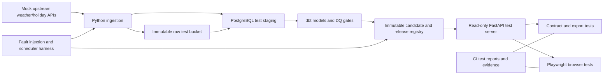

# OpenFactors — Testing & Quality Assurance Plan (Master Test Strategy)
> **Version:** 1.0 | **Status:** Draft for review | **Date:** 2026-10-23 | **Format:** Notion-ready Markdown

## 1. Purpose and governing documents
This plan defines **how to prove** that OpenFactors satisfies its Product Requirements Document, System Architecture (HLD), Data Models & Data Contracts (LLD), API Specification/OpenAPI 3.1, and Engineering Backlog & Sprint Planning. Tests are proposed, not executed; no passing results or production readiness is claimed.

**Document precedence:** PRD = scope; HLD = architecture boundaries; LLD = data truth and DQ-001–DQ-016; OpenAPI YAML = HTTP contract; backlog = delivery dependencies. Inconsistencies must be recorded as defects/ADRs and resolved across all sources before a test can be accepted. A test does not legitimize an undocumented contract change.

## 2. Test objectives and exit policy
- Prove one approved, immutable and fully traceable location-date dataset with 12 exact public fields; validate Asia/Manila date and holiday semantics, missing values, provenance and revisions.
- Prove only licensed/approved data is served, and failed candidates never replace last good release.
- Prove four public read-only endpoints, CSV and Parquet outputs, pagination consistency, safe errors, quotas and revocation.
- Prove operators can ingest, rerun, backfill, monitor, restore and rollback without silent data loss.
- **Release gate:** 100% of applicable P0 cases passed with attached evidence; no open Sev-1/Sev-2 defects; all governance decisions signed; all release-blocking DQ gates pass; owner signs go/no-go. P1 tests may remain deferred with approved scope.

## 3. Test architecture and isolation

**Environments:** developer unit tests; isolated CI integration (disposable PostgreSQL/object store and mock providers); staging end-to-end/security/load; production smoke tests using safe read-only endpoints. Never run destructive tests against production or depend on live provider availability for deterministic CI. Staging data must be synthetic or legally permitted. Freeze dependency versions and source fixtures.

## 4. Testing layers and tools
| Layer | Coverage | Recommended tooling | Trigger |
|---|---|---|---|
| Static | Python/SQL/TypeScript style, security, secrets | Ruff, mypy, ESLint, secret scan | Every PR |
| Unit | Parsing, date, holiday logic, pagination, serialization | pytest, property-based Hypothesis | Every PR |
| Data contract | 12 fields, FK/unique, DQ-001–016 | dbt test, SQL assertions, Pandera | Every PR + release candidate |
| Integration | Mock source→raw→stage→mart; checksum/replay | pytest, testcontainers/Docker Compose | Every PR + nightly |
| HTTP contract | OpenAPI 3.1 and response shapes/errors | openapi-spec-validator, Schemathesis or equivalent | Every API PR |
| Cross-format | JSON, CSV, Parquet same pinned rows | pandas/pyarrow, CSV parser | Every export PR |
| Browser | Discovery, dictionary, downloads, keyboard | Playwright, axe-core | Every UI PR |
| Resilience | Source outage, partial upload, DB fail, race, rollback | fault injection and concurrency harness | Pre-release + scheduled |
| Security | Read-only, roles, throttling, PII/logging | permission probes, dependency scan | Every release |
| Load/restore | Bounded p95, quotas, backups, runbooks | k6/Locust, restore scripts | Pre-release + periodic |

## 5. Fixtures and golden datasets
- **F-01** Two approved pilot locations and stable IDs; include an unknown location for 404 tests. Real locations only after OF-001 approval.
- **F-02** Dates around midnight Asia/Manila, weekend transition, leap day, start/end inclusivity; UTC offset correctness.
- **F-03** Weather: valid mean temperature, zero rainfall, missing rainfall, negative rainfall, high-but-plausible anomaly, changed revision.
- **F-04** Holidays: verified PH national holiday, non-holiday with complete calendar, missing/unknown calendar date, duplicate source declarations.
- **F-05** Raw: identical retries, partial object, mismatched SHA-256, schema drift, 429/5xx/timeouts.
- **F-06** Releases A/B: valid candidate, failed candidate, concurrent promotion, withdrawn/expired pinned release, old ETag.
- **F-07** HTTP: invalid dates, page=0, page_size=1001, missing required filters, malformed encoding, extra params, 429, 503.
- **F-08** Exports: CSV formula-prefix strings, nulls, Unicode holiday names, Parquet decimals/timestamps, over-cap data.
- **F-09** Operational: failed run, stale last-success timestamp, scheduler overlap, backfill replay, backup/restore snapshot.

**Fixture rule:** fixtures must contain only synthetic or approved test data and record expected output, source revision, checksum and local-date interpretation. Reference outcomes are reviewed independently from implementation logic to avoid circular tests.

## 6. API contract and endpoint coverage
| Endpoint (OpenAPI 3.1) | Test scope |
|---|---|
| `GET /api/v1/datasets` | Only published datasets, license/coverage/freshness, no candidate leakage |
| `GET /api/v1/datasets/daily-external-factors-ph` | 12-field dictionary, source attribution, release pin, unknown/withdrawn release |
| `GET /api/v1/factors/daily` | Location and inclusive date filters; page/page_size, 200 empty, 404/422/429/503, deterministic pinned release |
| `GET /api/v1/exports/daily-external-factors-ph` | `format=csv|parquet`, identical logical data, correct metadata/headers, quotas and download integrity |
| `GET /openapi.json` | Generated schema conforms to reviewed YAML, no undocumented public mutation paths |

Errors: 400 malformed encoding, 404 unknown/withdrawn, 405 unsupported method, 422 invalid filters, 429 Retry-After, 500 safe trace, 503 dependency unavailable; gateway 413/414/502/504 must be documented if emitted. Contract tests must compare exact schemas and stable machine error codes, not only HTTP status.

## 7. LLD quality gates — complete coverage
| Rule | Test ID | Required outcome |
|---|---|---|
| DQ-001 | QA-019 | Unapproved source blocks |
| DQ-002 | QA-020 | Corrupt bytes block |
| DQ-003 | QA-021 | Invalid types or units quarantined |
| DQ-004 | QA-022 | Orphan location/date/source blocked |
| DQ-005 | QA-023 | Negative mm blocked |
| DQ-006 | QA-024 | Same winning revision on repeat |
| DQ-007 | QA-025 | Missing calendar day blocks |
| DQ-008 | QA-026 | Duplicate composite key blocks |
| DQ-009 | QA-027 | All fields/types/nullability exact |
| DQ-010 | QA-028 | Below 99% approved-denominator coverage blocks |
| DQ-011 | QA-029 | Excluded gaps separately reported |
| DQ-012 | QA-030 | Inconsistent flags/names/weekend blocked |
| DQ-013 | QA-031 | Manifest row count/hash mismatch blocks |
| DQ-014 | QA-032 | Mixed versions blocked |
| DQ-015 | QA-033 | Same release/filter rows and types match |
| DQ-016 | QA-034 | Warning emitted and investigation recorded |

DQ-001–DQ-015 are release-blocking. DQ-016 is a warning that must be visible and investigated but is not automatically a blocker unless an approved escalation threshold is crossed. Coverage ≥99% is computed using approved expected location-date denominator and separately disclosed exclusions; unknown holiday dates are not silently excluded.

## 8. Requirements traceability — PRD to executable tests
| Requirement | Test IDs | Evidence and acceptance |
|---|---|---|
| FR-01 | QA-001, QA-002, QA-006, QA-007, QA-008, QA-012, QA-013, QA-083 | Ticket links, CI artifacts and reviewer acceptance; scope-based P1/excluded exceptions documented |
| FR-02 | QA-002, QA-009, QA-010, QA-011, QA-025, QA-030, QA-083 | Ticket links, CI artifacts and reviewer acceptance; scope-based P1/excluded exceptions documented |
| FR-03 | QA-002, QA-015, QA-016, QA-019, QA-020, QA-056, QA-076, QA-077, QA-078, QA-083, QA-086 | Ticket links, CI artifacts and reviewer acceptance; scope-based P1/excluded exceptions documented |
| FR-04 | QA-001, QA-004, QA-007, QA-011, QA-014, QA-021, QA-022, QA-023, QA-024, QA-026, QA-027, QA-030, QA-032, QA-083, QA-085, QA-086, QA-087 | Ticket links, CI artifacts and reviewer acceptance; scope-based P1/excluded exceptions documented |
| FR-05 | QA-003, QA-010, QA-014, QA-023, QA-025, QA-026, QA-028, QA-029, QA-031, QA-032, QA-034, QA-035, QA-036, QA-037, QA-038, QA-039, QA-040, QA-082, QA-083 | Ticket links, CI artifacts and reviewer acceptance; scope-based P1/excluded exceptions documented |
| FR-06 | QA-041, QA-042, QA-064, QA-065, QA-066, QA-083, QA-084 | Ticket links, CI artifacts and reviewer acceptance; scope-based P1/excluded exceptions documented |
| FR-07 | QA-033, QA-057, QA-058, QA-059, QA-060, QA-061, QA-062, QA-063, QA-066, QA-067, QA-083 | Ticket links, CI artifacts and reviewer acceptance; scope-based P1/excluded exceptions documented |
| FR-08 | QA-004, QA-033, QA-038, QA-041, QA-042, QA-043, QA-044, QA-045, QA-046, QA-047, QA-048, QA-049, QA-050, QA-051, QA-052, QA-053, QA-054, QA-055, QA-056, QA-060, QA-061, QA-068, QA-078, QA-079, QA-080, QA-083, QA-084, QA-085 | Ticket links, CI artifacts and reviewer acceptance; scope-based P1/excluded exceptions documented |
| FR-09 | QA-012, QA-013, QA-016, QA-017, QA-018, QA-070, QA-071, QA-072, QA-073, QA-076, QA-081, QA-083 | Ticket links, CI artifacts and reviewer acceptance; scope-based P1/excluded exceptions documented |
| FR-10 | QA-005, QA-034, QA-074, QA-075, QA-079, QA-080, QA-081, QA-082, QA-083, QA-084 | Ticket links, CI artifacts and reviewer acceptance; scope-based P1/excluded exceptions documented |
| FR-11 | QA-088 | Ticket links, CI artifacts and reviewer acceptance; scope-based P1/excluded exceptions documented |
| FR-12 | QA-051, QA-069 | Ticket links, CI artifacts and reviewer acceptance; scope-based P1/excluded exceptions documented |
| US-01 | QA-041, QA-064 | Ticket links, CI artifacts and reviewer acceptance; scope-based P1/excluded exceptions documented |
| US-02 | QA-042, QA-065 | Ticket links, CI artifacts and reviewer acceptance; scope-based P1/excluded exceptions documented |
| US-03 | QA-057, QA-067 | Ticket links, CI artifacts and reviewer acceptance; scope-based P1/excluded exceptions documented |
| US-04 | QA-059, QA-067 | Ticket links, CI artifacts and reviewer acceptance; scope-based P1/excluded exceptions documented |
| US-05 | QA-043, QA-068 | Ticket links, CI artifacts and reviewer acceptance; scope-based P1/excluded exceptions documented |
| US-06 | QA-002, QA-019, QA-029, QA-063, QA-064 | Ticket links, CI artifacts and reviewer acceptance; scope-based P1/excluded exceptions documented |
| US-07 | QA-017, QA-018, QA-071, QA-073 | Ticket links, CI artifacts and reviewer acceptance; scope-based P1/excluded exceptions documented |
| US-08 | QA-036 | Ticket links, CI artifacts and reviewer acceptance; scope-based P1/excluded exceptions documented |
| US-09 | QA-088 | Ticket links, CI artifacts and reviewer acceptance; scope-based P1/excluded exceptions documented |
| US-10 | QA-072, QA-090 | Ticket links, CI artifacts and reviewer acceptance; scope-based P1/excluded exceptions documented |
| US-11 | QA-003, QA-039, QA-040, QA-089 | Ticket links, CI artifacts and reviewer acceptance; scope-based P1/excluded exceptions documented |
| US-12 | QA-091 | Ticket links, CI artifacts and reviewer acceptance; scope-based P1/excluded exceptions documented |

## 9. Backlog traceability and phase gates
| Phase | Primary tickets | Required QA exit evidence |
|---|---|---|
| S0 | OF-001–005 | Approved locations, rights, retention, deployment and contract reconciliation |
| S1 | OF-006–010 | CI, migrations, role boundaries, contract fixtures |
| S2 | OF-011–015 | Deterministic source ingestion, checksum, retry, idempotency |
| S3 | OF-016–020 | dbt models, local-date logic, exact 12-column mart |
| S4 | OF-021–025 | All blocking DQ gates, atomic publish, rollback, takedown |
| S5 | OF-026–030 | All public JSON routes, error taxonomy, OpenAPI parity |
| S6 | OF-031–033 | CSV/Parquet equivalence, formula safety, caps |
| S7 | OF-034–036 | Catalog, dictionary, downloads, keyboard UX |
| S8 | OF-037–040 | Scheduler, authorized backfill, monitoring, restore drill |
| S9 | OF-041–044 | Security/load, release evidence audit, controlled deployment |
| Post-MVP | OF-045–047 | Optional acceptance if prioritized |
| Out of scope | OF-048–049 | Explicitly absent; no user accounts or economic indicators in MVP |

## 10. Severity, triage and release blockers
| Severity | Example | Response |
|---|---|---|
| Sev-1 | Unauthorized data exposure, unlicensed publication, corrupted public release, broken rollback | Stop release; incident escalation |
| Sev-2 | Wrong holiday semantics, schema drift, API/export mismatch, failed required gate, missing backups | Block release; fix and rerun regression |
| Sev-3 | Noncritical UX issue with workaround, cosmetic docs issue | Triage and owner approval |
| Sev-4 | Cosmetic or future enhancement | Backlog |

Every failed test records expected/actual, reproduction steps, environment, run/release ID, severity, owner, linked defect, and retest evidence. Flaky tests are quarantined with an issue and deadline; they cannot be silently treated as passing for release-blocking coverage.

## 11. Non-functional measurement methodology
- **API performance:** cached bounded common query p95 <1s under a signed-off concurrency, query shape, dataset size and duration. Record sample count, environment, cache warmup and confidence; exports measured separately.
- **Data coverage:** ≥99% expected location-date rows after approved exclusions; report denominator, missing upstream dates and exclusions distinctly.
- **Idempotency:** zero duplicate `(release_id, location_id, date)` and stable winning revision after repeated/overlapping runs.
- **Pipeline reliability:** ≥99% successful scheduled runs over rolling 30 days. A prelaunch test cannot prove a 30-day SLO; release may be conditionally approved with monitored postlaunch evaluation, explicit owner and rollback threshold.
- **Freshness:** show last attempted run, last successful ingestion and last published release independently. Daily *attempt* is not a guarantee of daily fresh source data.
- **Disaster recovery:** document measured RPO/RTO and test against approved targets once OF-003/OF-004 decisions are signed; do not invent numbers.

## 12. CI/CD gates and test execution cadence
1. Pull request: lint/types/secret scan, unit tests, dbt schema fixtures, OpenAPI validation and changed-path integration.
2. Merge to main: full seeded integration, cross-format contract, browser smoke and migration verification.
3. Release candidate: all P0 cases, security checks, quality/promotion/withdrawal fault injection, load test and restore drill.
4. Production rollout: read-only smoke, metric/alert verification and documented rollback readiness.
5. Postlaunch: daily pipeline health, weekly flaky/incident review, monthly restore/reliability report.

## 13. Required evidence package for go/no-go
- Signed ADRs for locations, historical bounds, license/redistribution, holiday authority, retention/withdrawal, budgets/ownership and query/export caps.
- Source-to-target lineage and reviewed 12-column schema snapshot, DQ-001–016 results and quality/coverage report.
- OpenAPI YAML validation + runtime parity diff; request/response and CSV/Parquet golden fixture results.
- Atomic publish, concurrent pinned paging, cache withdrawal, fault injection and rollback transcripts.
- DB permission and security results; dependency/secret scans; operational log retention approval.
- Measured load report, restore evidence, alert routing and postlaunch 30-day reliability measurement plan.
- Test-case CSV with `Status=Passed`, evidence links and zero unresolved release-blocking defects; Product Owner and technical owner sign-off.

## 14. Explicit unresolved decisions and potential loopholes
| Decision / risk | Blocking validation |
|---|---|
| Approved pilot locations and historical bounds | No final data fixture/query-limit acceptance until approved |
| Weather and holiday redistribution rights | No public publish until approved; public API and exports count as redistribution |
| Authoritative national holiday completeness | Unknown cannot be silently interpreted as false |
| Retention, takedown and CDN invalidation | Revoked release must be inaccessible despite cached URL/ETag |
| Exact nullability and revision precedence | Align LLD, OpenAPI, dbt and exports via OF-005 before schema freeze |
| Rate limits, export ceilings, expected load and cost | Test against agreed numbers, not provisional defaults |
| Availability and RPO/RTO commitments | Do not assert unapproved SLA or recovery targets |
| Gateway error behavior | Normalize or document 413/414/502/504; test realistic deployed gateway |

**No loophole guarantee:** This document is a proposed verification plan. It cannot guarantee zero defects or eliminate unknown unknowns. The defensible standard is documented coverage, deterministic tests, adversarial scenarios, controlled decisions and traceable evidence.

## 15. Notion workflow
Import this Markdown file as **06 — Testing & Quality Assurance Plan**. Import `OpenFactors_QA_Test_Cases_Notion_Import_v1.csv` as a separate Notion database. Set `Status` and `Priority` as Select fields, `Release_Blocker` as Select or checkbox, and create optional Relations to your engineering backlog using `Backlog_IDs`. Each test starts **Not run**; no fictitious passes.

## 16. Review checklist
- [ ] Every PRD FR and US has at least one test or explicit deferred/excluded scope check
- [ ] Every LLD DQ-001–DQ-016 is mapped to a test and gate behavior
- [ ] All four OpenAPI public endpoints and generated schema are exercised
- [ ] All 49 backlog items have acceptance evidence or documented exclusion/deferment
- [ ] Negative paths cover retries, corruption, malformed inputs, rollback, withdrawal and unauthorized access
- [ ] All blockers and ADRs resolved before public go/no-go
- [ ] Actual CI/test execution evidence and release approvals attached

## Appendix — Document control
| Version | Date | Status |
|---|---|---|
| 1.0 | 2026-10-23 | Draft, test cases unexecuted |
