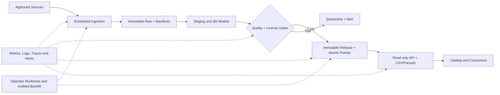

# OpenFactors — Operations & Monitoring Plan and Production Runbooks

> **Version:** 1.0 · **Status:** Draft / not production-approved · **Date:** 2026-10-23 · **Audience:** Lead Data Engineer, Platform/SRE, Backend, Product, QA and incident responders  
> **Import:** Notion → Import → Markdown. Import companion `OpenFactors_Operations_Runbook_Register_Notion_Import_v1.csv` as a separate database.

## 1. Document authority, alignment and limits

This is the operational implementation of the existing **PRD v1**, **HLD v1**, **LLD v1**, **API Specification v1 + OpenAPI 3.1 YAML**, **Engineering Backlog v1** and **QA Plan v1**. The operational requirements are traceable below. It does **not** override the approved product/data/HTTP contracts. Where contracts disagree, **OF-005** requires a documented ADR and coordinated updates before implementation.

**Normative priority:** PRD (scope and users) → HLD (system boundaries and publication model) → LLD (data semantics and persistence) → OpenAPI (HTTP wire contract) → backlog (implementation acceptance) → QA (verification evidence) → this plan (operational procedures). Each has authority over its own domain, rather than a blanket “last document wins” rule.

**Not a zero-defect guarantee:** Unknown provider behavior, infrastructure failures, legal changes and human error cannot be eliminated by documentation. Release is blocked on unresolved critical controls, tested runbooks and named accountable owners.

## 2. Production operating model

| Area | Design and operating boundary | Owner role |
|---|---|---|
| Sources | Approved weather and national PH holiday providers; no public release without rights review | Product/legal + Data |
| Ingestion | Python HTTP connectors, bounded retries, per-run manifests and immutable raw checksums | Data Engineer |
| Storage | Private raw objects; PostgreSQL control/staging/conformed/quality/publish schemas | Data/Platform |
| Transform | dbt staging, dimensions, facts, 12-field `daily_external_factors_ph` gold mart | Data Engineer |
| Publication | Immutable `release_id`; quality-gated candidate; atomic active pointer; last-good remains on failure | Data/Platform |
| Serving | Read-only FastAPI + bounded CSV/Parquet exports; public DB principal cannot read raw/staging | Backend/Platform |
| Experience | Catalog, dictionary, freshness, attribution and downloads | Frontend/Product |
| Operations | Daily scheduler, audited operator CLI backfill, metrics, alerts, incident response and restore | Platform/Data |
| Governance | Source license, retention, withdrawal, disclosure, costs and SLO approvals | Product/Legal/Tech Lead |



**Isolation:** dev, test, staging and production credentials/storage must not overlap. No unauthenticated public ingestion, backfill, release promotion, restore, delete or admin endpoint. API credentials are read-only on approved serving objects. Audit logging must not expose provider secrets or private credentials.

## 3. Service-level objectives and what is actually measured

| Indicator | Contract / target | Calculation and source | Operational response |
|---|---|---|---|
| Scheduled run reliability | ≥99% successful scheduled runs over rolling 30 days | Successful scheduled logical intervals / due scheduled logical intervals. Retries count toward the same interval, not extra successes; no hidden denominator exclusions | Warn when trending below target; investigate every missed interval |
| Location-date coverage | ≥99% expected supported keys, with explicitly approved exclusions | Distinct published `(location_id, date)` / approved expected location-date keys; show both gross and adjusted denominators | Candidate quality gate blocks below target; report exceptions publicly |
| Uniqueness | Zero duplicates per `(release_id, location_id, date)` | dbt/SQL unique tests on candidate and published rows | Hard block release |
| API latency | p95 <1 second for **bounded cached common query** under signed-off load profile | Histogram from gateway/app plus prelaunch load report recording concurrency, data size, warm cache, request shape | Alert on sustained breach; examine DB and gateway |
| Daily refresh | Daily scheduled **attempt** and truthful last-good timestamp | Scheduler due/attempt/last_success/last_published timestamps kept distinct | Missed-run alert; do not claim upstream freshness not achieved |
| Availability | **No numeric uptime SLA approved yet** | HTTP success/5xx/latency, synthetic checks, incident minutes | Define numeric SLO only via approved ADR |
| Recovery | **RPO/RTO unapproved**; restore drill required prelaunch | Measured time and data-loss window from staged restore | No production beta until owner accepts measured targets |
| Cost | Budget cap unapproved | Storage, compute, API requests, object egress and third-party quota | Budget alarms and cost review required before beta |

**Measurement safeguards:** Persist denominator, timezone, metric source and evaluation window. Missing telemetry is not a success. Avoid using “last attempt” as “last successful publication”. Short prelaunch testing cannot prove a rolling 30-day reliability SLO; use explicit conditional acceptance with a 30-day postlaunch review if Product Owner authorizes.

## 4. Observability contract

### 4.1 Structured logs

Use JSON log events with UTC timestamp, `environment`, `service`, `event_name`, `severity`, `trace_id`, `run_id`, `candidate_release_id`/`release_id`, `source_id`, `location_id` where appropriate, `error_code`, `retry_count`, `duration_ms`, and `outcome`. Avoid raw payload bodies and personally identifying query data in normal logs. Hash or redact secrets and signed download URLs. Use trace IDs for incident correlation, never as authorization tokens.

### 4.2 Metrics

| Metric name (proposed; names must be frozen in implementation) | Type | Purpose |
|---|---|---|
| `pipeline_runs_total{source,status}` | Counter | Reliability numerator/denominator from scheduled run registry |
| `pipeline_run_duration_seconds{source}` | Histogram | Duration and regressions |
| `pipeline_last_success_timestamp_seconds{source}` | Gauge | Last successful ingestion |
| `pipeline_last_publish_timestamp_seconds{dataset}` | Gauge | Last successful public release |
| `scheduler_last_heartbeat_timestamp_seconds` | Gauge | Scheduler liveness |
| `ingestion_requests_total{source,status_class}` | Counter | Provider failures, throttling |
| `ingestion_retry_total{source,reason}` | Counter | Retry pressure |
| `raw_checksum_failures_total{source}` | Counter | Immutable archive integrity |
| `quality_rule_failures_total{rule_id}` | Counter | DQ-001–DQ-016 trends |
| `candidate_coverage_ratio{dataset}` | Gauge | Candidate location-date completeness |
| `holiday_unknown_dates{dataset}` | Gauge | Unverified calendar dates |
| `release_promotion_total{status}` | Counter | Atomic publication outcomes |
| `active_release_age_seconds{dataset}` | Gauge | Staleness and catalog truth |
| `api_requests_total{route,status_class}` | Counter | Traffic and errors |
| `api_request_duration_seconds{route}` | Histogram | Bounded query p95 |
| `api_rate_limited_total{route}` | Counter | Abuse/throttling |
| `export_failures_total{format}` | Counter | Export health |
| `db_pool_wait_seconds{service}` | Histogram | DB resource pressure |
| `backup_last_success_timestamp_seconds{target}` | Gauge | Backup freshness |
| `backup_restore_verification_status{target}` | Gauge | Restore-drill evidence |
| `object_egress_bytes_total{service}` | Counter | Cost control |

**Cardinality controls:** Never use arbitrary IP, URL, request ID, run ID, release ID, exception text, exact timestamp or location ID as a metric label. Keep high-cardinality IDs in logs/traces. Histograms require appropriately chosen buckets; verify scrape/alert behavior in staging.

### 4.3 Traces and synthetic probes

Trace scheduler → fetch → archive → transform → validate → publish, and gateway → API → DB. Preserve run IDs across async tasks; avoid exporting raw payloads. Synthetic checks query the published catalog, a small pinned valid factor slice and one tiny export, using approved test geography/date. Do not let synthetic traffic bypass throttling unless explicitly isolated.

### 4.4 Dashboards

**Executive/data product:** active release, published-at vs data-as-of, approved geography/date coverage, exclusions, licensing status, download success.  
**Data platform:** due/success/failed scheduled intervals, run duration, source 429/5xx, raw checksum, quarantined rows, each DQ rule, candidate vs active release.  
**API and infrastructure:** request volume, 4xx/5xx, latency p50/p95/p99, 429, export failures/size, DB pool/CPU/disk, backup status, cost.  
**Incident:** current alert, affected service/dataset/release, last-good, owner, runbook, incident timeline and recent deployment.

## 5. Alerting and escalation

| Alert | Initial trigger (provisional) | Severity | Response |
|---|---|---|---|
| Scheduler missing | Heartbeat absent for 2 expected heartbeat intervals, or daily due interval not attempted by agreed deadline | SEV2 | RB-10 |
| Pipeline failures | Scheduled interval fails after bounded retries | SEV2 | RB-01/RB-02 |
| Quality release block | Any DQ-001–015 hard gate fails | SEV2 | RB-02/03/04 |
| Source approval revoked | Source status becomes unapproved while publicly served | SEV1 | RB-06 |
| Public release inconsistency | Mixed release pages, wrong active pointer or unapproved data visible | SEV1 | RB-05/RB-17 |
| API outage | Sustained 5xx >5% for 5 minutes with meaningful traffic; also synthetic check fails | SEV1 | RB-07 |
| Latency | Bounded-query p95 >1s for 15 minutes at representative traffic | SEV2 | RB-08 |
| Staleness | Active release older than approved freshness threshold, not simply >24h by default | SEV2 | RB-16 |
| Backup failure | Backup misses approved interval or checksum/restore verification fails | SEV1/2 | RB-12/RB-13 |
| Cost | 80% of approved monthly budget reached or rapid unplanned egress | SEV2 | RB-15 |

Thresholds, on-call response times and quiet hours are **provisional** until OF-003/OF-039 and QA sign-off. Alert deduplication and escalation prevent paging storms. SEV1 pages primary + backup owner immediately; SEV2 routes to assigned operational queue and escalates if user impact grows; SEV3 is planned remediation. Do not treat unresolved paging coverage as a functioning 24/7 support commitment.

## 6. Incident command and communication

**Roles:** Incident Commander (coordinates), Technical Lead (diagnoses), Communications Owner (public status), Scribe (timeline), Approver (release/restore decisions). A solo operator may combine roles but should preserve independent sign-off for destructive/legal actions when available.

1. **Detect:** acknowledge alert, record start time, symptoms, environment, current active `release_id`, affected locations/date range and user impact.
2. **Classify:** SEV1 integrity/security/public outage, SEV2 material degradation/stale data, SEV3 minor non-blocking issue. Escalate if uncertain.
3. **Contain:** stop candidate promotion or risky exports, protect last-good release, revoke compromised credentials if needed. Never bypass DQ gates to “fix freshness.”
4. **Diagnose:** correlate logs by trace/run/release, compare deployment changes, validate source terms, DB health and provider behavior.
5. **Recover:** use approved rollback/replay/restore procedure; verify integrity, OpenAPI smoke, export parity and catalog freshness.
6. **Communicate:** publish status using verified facts, last-good data date and known limitations. Avoid promising a restoration time without evidence.
7. **Close:** record exact actions, evidence, affected release(s), user impact, data loss if any, corrective tickets and owner.
8. **Postmortem:** within an agreed timeframe (provisional: five business days for SEV1), blameless root-cause analysis and tracked prevention.

**Status message template:** “OpenFactors is experiencing [verified issue] affecting [scope]. The most recent validated release is [release ID, published timestamp]. Data newer than [timestamp] may be unavailable. We are [verified mitigation]. Next update: [time if committed].”

## 7. Standard operating procedures

### SOP-01 — Daily health check

- Confirm scheduler heartbeat and expected daily interval was attempted.
- Inspect source connector results and retry/429 rates; distinguish temporary outage from license suspension.
- Compare `last_attempt`, `last_successful_ingestion`, `last_validated_candidate`, `last_published` and current `active_release_id`.
- Check DQ-001–015, warning DQ-016, gross/adjusted coverage and holiday unknown dates.
- Run bounded synthetic API and tiny export checks, inspect error rate/latency and DB saturation.
- Check backup completion and cost trend.
- Record any exception with ticket, owner and next review time. **Do not manually alter release rows or active pointer.**

### SOP-02 — Safe scheduled ingestion and idempotent replay

**Preconditions:** approved source license, valid location/date scope, least-privileged operator, source quota budget, known prior run status.  
**Execution:** create audited `run_id`; fetch with bounded timeout/retries respecting `Retry-After`; archive raw bytes and SHA-256; parse/normalize; load staging idempotently; run dbt; compute DQ evidence; build candidate release.  
**Decision:** publish only when all blocking gates pass and source remains approved; otherwise quarantine candidate, alert and preserve last-good active release.  
**Verification:** expected row counts, no duplicate source interval, checksums, source lineage, `release_id` and active pointer consistent.  
**Failure:** stop after retry budget, mark interval failed, schedule authorized retry; never label failed as success.

### SOP-03 — Controlled historical backfill

1. Authorize requester and reason; define source, approved location set, inclusive local-date interval, revision policy and expected volume.
2. Record incident/change ticket, dry-run output, license/quota checks and operator identity.
3. Run CLI in `--dry-run` mode first; ensure lock/lease prevents conflicting interval publication.
4. Run actual backfill with checkpointing and immutable raw archiving; idempotent reruns must not duplicate keys.
5. Validate weather revision precedence, holiday completeness, DQ-001–015, 12-field contract and expected coverage.
6. Publish **new immutable release** through the normal approval/promotion path; do not rewrite old releases.
7. Compare old/new content and log known historical corrections. Verify pinned old release behavior subject to retention/withdrawal policy.
8. Close with run ID, checksums, validation report, new release ID and user-facing revision disclosure if required.

**CLI syntax is illustrative, not an implemented command:**
```bash
python -m openfactors.ops.backfill --source weather   --location-id PH-EXAMPLE --start-date 2024-01-01   --end-date 2024-01-31 --dry-run
```

### SOP-04 — Candidate validation and atomic publication

- Confirm source approvals are valid at promotion time, not only at ingestion.
- Validate manifest row count, hash, schema version, permitted geography, uniqueness `(release_id, location_id, date)`, required 12 fields, holiday and weather semantics, and approved coverage denominator.
- Produce immutable candidate release and evidence bundle. In a single DB transaction, re-check candidate state and switch `active_release_id` with concurrency control.
- On any failed gate or transaction, retain last-good release; quarantine failed candidate. A failed publish must never produce mixed public rows.
- After success, check API catalog, dictionary, paginated query and export against **the same** release ID. Keep prior release according to approved retention policy.

### SOP-05 — Rollback application or dataset release

**Distinguish:** application rollback (redeploy previous compatible image) versus dataset rollback (atomically repoint to a previously validated, **still approved and accessible** immutable release). Never reactivate a legally withdrawn release.  
**Preconditions:** incident/change approval, candidate target release verified, schema compatibility checked, cached artifacts and CDN behavior understood.  
**Action:** pause competing promotions; use approved transaction-backed promotion/rollback mechanism; do not issue direct ad-hoc UPDATE to release tables.  
**Verify:** active pointer, checksums, catalog freshness disclosure, pinned pagination, CSV/Parquet parity, HTTP 200/404/422/429/503 behavior, audit log.  
**Abort/escalate:** target release missing, license unapproved, schema incompatible, validation failed or partial cache invalidation.

### SOP-06 — Urgent withdrawal and cache invalidation

- Record source/legal decision, affected source, data products, releases, files, API paths and scope.
- Prevent new candidate/publication using source immediately; mark affected releases unavailable using approved state transition.
- Purge or revoke **all controlled** public surfaces: API caches, CDN objects, signed links, export artifacts, catalog references and old pinned releases.
- Test that affected `release_id` returns contract-compliant 404; validate unaffected releases remain available. Document inability to retract already-downloaded third-party copies.
- Record start/end of withdrawal, actual purge propagation time, legal approval and evidence. **Release takedown completion window must be approved**; do not claim an unmeasured guarantee.

### SOP-07 — Backup and isolated restore

**Backup set:** PostgreSQL schemas including manifests, source registry, quality runs, release metadata and active pointer; immutable raw objects and released export artifacts if retention requires them; secrets and IaC backed up separately in approved vaults.  
**Procedure:** verify last successful backup and encryption; restore to isolated nonproduction infrastructure; verify referential integrity, raw checksums, expected row counts, candidate/active release pointers, role restrictions and synthetic API/CSV/Parquet outputs; record measured RPO and RTO; obtain cutover authorization if production restore is needed.  
**Safety:** never overwrite production before proving integrity and rollback plan. Do not restore revoked/withdrawn data into public service. Log all privileged actions.

### SOP-08 — API and export degradation

- Identify affected route, response status, trace IDs, current release and scope. Check 429/Retry-After, 503 dependency failures, 500 internal errors, DB pool and slow queries.
- Confirm bounded filters and query caps; prevent large exports from starving small JSON queries. Throttle or temporarily disable costly exports only with product/incident approval and truthful status.
- If recent code change, roll back app to compatible version. If database issue, recover via approved process; do not corrupt or repoint release as a shortcut.
- Verify the four public API paths, `/openapi.json`, negative errors, pinned pagination, CSV/Parquet round trip and rate limiting.

### SOP-09 — Security and secret exposure

- Restrict compromised principal/service, rotate secrets, invalidate sessions/tokens where applicable, preserve tamper-evident logs.
- Verify no public access to raw/staging/control tables and no write/admin endpoints.
- Assess exposure, legal/privacy notification obligations, remediation and credential reuse.
- Re-enable only after least-privilege and negative authorization tests pass, with security owner sign-off.

### SOP-10 — Change, deploy and rollback

- PR must link requirement IDs, OF ticket(s), QA tests and impact to PRD/HLD/LLD/OpenAPI. Review migrations, contract compatibility and provider terms.
- CI: lint/types, schema and contract checks, dbt tests, API OpenAPI diff, security scans, smoke/negative tests. Never deploy with release-blocking tests waived without recorded product/security approval.
- Deploy to staging; verify new image and migrations; test existing pinned releases and export parity.
- Progressive production deployment; monitor synthetic/API/data quality and error budget. Roll back **application** if regression, without automatically reverting data.
- Record deploy SHA, migration ID, contract version, change approver, verification links and incident/rollback outcome.

## 8. Incident runbook register (Notion database)

The companion CSV has one record per scenario with `Runbook_ID`, `Backlog_IDs`, `QA_Test_IDs`, alert signals, severity, containment, recovery exit, status, owner and drill evidence.

| ID | Scenario | Severity | Backlog links | QA links |
|---|---|---|---|---|
| RB-01 | Upstream timeout / 429 / 5xx | SEV2 | OF-011,OF-012,OF-013,OF-015,OF-037 | QA-012,QA-013,QA-070 |
| RB-02 | Schema drift or malformed raw payload | SEV2 | OF-014,OF-017,OF-021,OF-037 | QA-014,QA-021,QA-036 |
| RB-03 | Low coverage or unknown holiday calendar | SEV2 | OF-013,OF-019,OF-022,OF-024 | QA-010,QA-025,QA-028,QA-036 |
| RB-04 | Duplicate keys / revision inconsistency | SEV2 | OF-015,OF-019,OF-021 | QA-024,QA-026,QA-073 |
| RB-05 | Failed or concurrent release promotion | SEV1 | OF-023,OF-024 | QA-035,QA-037,QA-082 |
| RB-06 | License revocation / urgent withdrawal | SEV1 | OF-002,OF-004,OF-025 | QA-003,QA-039,QA-063 |
| RB-07 | API elevated 5xx / dependency outage | SEV1 | OF-028,OF-029,OF-039 | QA-053,QA-054,QA-084 |
| RB-08 | Slow API / exhausted pool / abuse | SEV2 | OF-028,OF-033,OF-039,OF-041,OF-042 | QA-052,QA-080 |
| RB-09 | CSV/Parquet export corruption or mismatch | SEV2 | OF-031,OF-032,OF-033 | QA-057,QA-059,QA-060 |
| RB-10 | Scheduler stopped / missed run | SEV2 | OF-037,OF-039 | QA-070,QA-071,QA-074 |
| RB-11 | Backfill error / partial replay | SEV2 | OF-015,OF-038 | QA-072,QA-073 |
| RB-12 | Database unavailable / restore | SEV1 | OF-007,OF-040 | QA-076,QA-082 |
| RB-13 | Object storage missing / checksum failure | SEV1 | OF-008,OF-014,OF-040 | QA-015,QA-016,QA-077 |
| RB-14 | Unauthorized read / secret compromise | SEV1 | OF-010,OF-041 | QA-078,QA-079 |
| RB-15 | Cost spike / quota exhaustion | SEV2 | OF-003,OF-033,OF-039 | QA-005,QA-061,QA-080 |
| RB-16 | Stale public data / misleading freshness | SEV2 | OF-026,OF-034,OF-039 | QA-064,QA-074,QA-075 |
| RB-17 | API release pin returns inconsistent pages | SEV1 | OF-024,OF-028 | QA-038,QA-045 |
| RB-18 | Deployment regression / rollback | SEV1 | OF-030,OF-041,OF-043,OF-044 | QA-082,QA-083,QA-084 |

**Procedure standard for every runbook:** (a) trigger and symptoms; (b) customer/data impact; (c) prerequisites/permissions; (d) containment; (e) diagnostics; (f) recovery actions; (g) verification and exit; (h) rollback/abort; (i) communication and escalation; (j) incident evidence. The detailed SOPs above apply to these scenario-specific records; split individual RB pages in Notion when operating procedures mature.

## 9. Full PRD requirement-to-operations traceability

| Requirement | Operational control and proof |
|---|---|
| FR-01 | Approved weather source, run manifest, retry/backfill, weather date and missingness monitoring |
| FR-02 | Approved national PH holiday authority, calendar completeness alert, unknown-date quarantine |
| FR-03 | Immutable raw/checksum, private storage, backup/restore, retention/withdrawal |
| FR-04 | 12-field schema checks, dbt tests, local-date and revision monitoring |
| FR-05 | DQ-001–015 hard gates, coverage, candidate quarantine, atomic promotion and rollback |
| FR-06 | Catalog metadata, dictionary, freshness and attribution synthetic checks |
| FR-07 | CSV/Parquet typed round trip, parity, quotas, export failure monitoring |
| FR-08 | Read-only API, 4 endpoint smoke checks, `/openapi.json`, error taxonomy, release pin, rate limiting |
| FR-09 | Daily orchestration, bounded retries, audited CLI backfill, run reconciliation |
| FR-10 | Metrics, logs, dashboards, alerts, incidents, backup/restore, load/cost SLOs |
| FR-11 | Post-MVP examples: documentation checks and pinned-release sample verification |
| FR-12 | Excluded: confirm no accounts, login or workspace operational dependency |
| US-01 | Catalog discovery and coverage/freshness availability |
| US-02 | Dictionary completeness and nullability/units |
| US-03 | CSV download and parity |
| US-04 | Parquet download and typed metadata |
| US-05 | API filters, stable release pagination and developer documentation |
| US-06 | Source/attribution/license disclosure and freshness |
| US-07 | Replay-safe ingestion, revision selection and lineage |
| US-08 | Quality-gated publication and failed candidate containment |
| US-09 | Post-MVP join examples and validation |
| US-10 | Required audited CLI backfill; enhanced operator UI optional |
| US-11 | Required internal immutable release history; enhanced user-facing change log optional |
| US-12 | Excluded monthly economic indicator sources |

## 10. Engineering backlog and QA evidence integration

| Sprint / tickets | Operational deliverable | Required verification |
|---|---|---|
| S0 / OF-001–005 | Governance approvals, named owners, recovery targets, source/retention policy | QA-001–005 |
| S1 / OF-006–010 | Environments, roles, registry, backup architecture, CI | QA-078, QA-085–086 |
| S2 / OF-011–015 | Connector retry, immutable raw, checkpoints, audit logs | QA-006–018 |
| S3 / OF-016–020 | Warehouse/dbt models, provenance, gold mart | QA-019–034, QA-087 |
| S4 / OF-021–025 | DQ gates, atomic publication, withdrawal and rollback | QA-019–040 |
| S5 / OF-026–030 | Public read-only API, runtime OpenAPI parity | QA-041–056 |
| S6 / OF-031–033 | Exports, quotas, typed consistency | QA-057–063 |
| S7 / OF-034–036 | Truthful catalog, dictionary, UX and docs | QA-064–069 |
| S8 / OF-037–040 | Daily scheduler, CLI backfill, monitoring, restore runbooks | QA-070–077 |
| S9 / OF-041–044 | Security, load, rollback, evidence review and beta | QA-078–084 |
| Post-MVP / OF-045–047 | Examples, change log, operator UX | QA-088–090 |
| Excluded / OF-048–049 | No user accounts or economic indicators | QA-069, QA-091 |

**Quality rules:** DQ-001–015 are publication blockers; DQ-016 is an anomaly warning with documented escalation threshold. Operational evidence must link to the QA case and backlog ticket. QA test statuses begin *Not run*; a written procedure is not proof it passed.

## 11. API operations contract

These are the only MVP public data endpoints in the approved OpenAPI YAML:

| Endpoint | Health and incident assertions |
|---|---|
| `GET /api/v1/datasets` | Only published/approved catalog entries; accurate coverage and freshness |
| `GET /api/v1/datasets/daily-external-factors-ph` | Exact 12-field dictionary and source terms; optional pinned `release_id` |
| `GET /api/v1/factors/daily` | Required location/date filters; inclusive dates; page ≥1, size 1–1000; deterministic pinned release |
| `GET /api/v1/exports/daily-external-factors-ph` | `format=csv|parquet`, exact row parity, quotas, attribution and cache controls |

`GET /openapi.json` is an implementation discovery endpoint, not a fifth product dataset endpoint. HTTP behavior: 200 valid empty slice; 400 malformed syntax; 404 unknown/withdrawn; 405 unsupported method; 422 invalid filters; 429 with `Retry-After`; 500 safe trace ID; 503 dependency unavailable. Gateway-specific 413/414/502/504 must be documented and tested if emitted. Never silently substitute active release when a requested pinned release is unavailable.

## 12. Backup, retention and disaster recovery decision record

| Control | Required before beta | Current status |
|---|---|---|
| PostgreSQL backup cadence and verified encryption | Select hosting-dependent schedule; test integrity | OPEN |
| Raw object versioning/backup and restore | Approve immutable artifact retention and storage budget | OPEN |
| RPO target | Approved max acceptable data loss, measured in restore drill | OPEN |
| RTO target | Approved max recovery time, measured in restore drill | OPEN |
| Old-release retention and withdrawal policy | Working baseline in ADR-004: keep published releases, no public cache, no offsite copy | ADR-004 |
| Restore authority and access control | Named primary/backup owner; privileged operations audited | OPEN |
| Restore drill evidence | QA-076/077, OF-040; isolated recovery with checksums and API smoke | NOT RUN |
| Availability/incident support window | Explicit support schedule; no invented 24/7 promise | OPEN |

## 13. Operating cadence

| Frequency | Activity | Evidence |
|---|---|---|
| Every scheduled run | Run manifest, retries, checksum, DQ validation, candidate disposition | run ID + quality report |
| Daily | SOP-01 health check, source freshness, backup, API synthetic and cost trend | dashboard snapshot/incident ticket |
| Weekly | Review stale intervals, DQ warnings, alerts, capacity and open incidents | review notes and backlog changes |
| Monthly | SLO/error budget, spend, source license review, permissions, restore status | signed monthly ops review |
| Quarterly or after major change | Restore drill, release rollback and withdrawal drill, incident tabletop | QA/incident evidence |
| On source/API/schema change | ADR impact analysis and contract + runbook update | approved change record |

Cadence is proposed; operator availability, backup frequency and escalation hours require sign-off.

## 14. Change control, risk register and open decisions

| Decision | Required owner | Consequence if unresolved |
|---|---|---|
| D-01 pilot locations and identifiers | Product/Data | Cannot assert coverage or support queries |
| D-02 historical coverage/query limits | Product/Data/API | Cannot finalize backfill and bounded query policy |
| D-03 holiday authority and calendar semantics | Product/Data | Holiday data release unsafe |
| D-04 redistribution, attribution and takedown rights | Legal/Product | **Hard public launch blocker** |
| D-05 retention, release expiry and cache purge window | Product/Platform/Legal | Working baseline in ADR-004. A future public cache still needs a purge window. |
| D-06 deployment budget, ownership and load profile | Product/Platform | Cannot commit operational SLOs |
| D-07 source update timestamp/revision precedence | Data/API | LLD/OpenAPI parity incomplete |
| D-08 export size/rate limits | Backend/Platform | Resource-exhaustion controls unapproved |
| D-09 measured RPO/RTO and restore strategy | Product/Platform | **Hard beta blocker** |
| D-10 paging, escalation, alert thresholds and support window | Product/Platform | Incident response unowned |

**Change policy:** any change to fields, semantics, nullability, source approvals, publication state, retention, endpoint, pagination, error envelope or query limits requires impact review across all six prior documents, OpenAPI YAML, QA cases and this runbook register. New risks become tickets with owner and deadline.

## 15. Release go/no-go and operations readiness

- [ ] Product owner approves locations, history, source license and holiday policy.
- [ ] Source registry permits all fields and redistribution; attribution and known gaps displayed.
- [ ] DQ-001–015 pass and DQ-016 warnings are investigated; ≥99% approved coverage measured with visible denominators.
- [ ] Immutable raw and published releases have verified checksums, stable release pins and atomic promotion.
- [ ] Concurrent paging, rollback, withdrawal and cache purge drills pass.
- [ ] Four public endpoints and OpenAPI runtime contract tests pass; CSV/Parquet rows match.
- [ ] Public DB role cannot access raw/staging or mutate data; secrets and abuse controls tested.
- [ ] Scheduler, authorized CLI backfill and recovery/restore drills pass.
- [ ] Metrics, alert routing, on-call ownership, status communication and cost alarms are operational.
- [ ] RPO/RTO and load profile approved; measured restore and performance results recorded.
- [ ] All P0 backlog items accepted, QA release-blocking tests passed, no unresolved SEV1/critical issues.
- [ ] Go/no-go review signs residual risk, production version, rollback plan and named owner.

**No-go** if any required evidence is missing. Written runbooks, dashboards or tests without execution do not count as completed operational readiness.

## 16. Notion workspace instructions and ownership

Create page **07 — Operations & Monitoring** and import this Markdown. Import the companion CSV as **Runbook Register** database. Add relations to your engineering backlog and QA database by matching IDs; the CSV fields are text identifiers until manually linked. Recommended views: `SEV1`, `By Domain`, `Drill Due`, `Open Decisions`, `Owner`. Each live runbook should eventually contain tested commands for the *actual* deployed provider; do not copy illustrative commands into production without review.

### Document history

| Version | Date | Status | Notes |
|---|---|---|---|
| 1.0 | 2026-10-23 | Draft | Initial operating model, observability, SOPs, incident register and cross-document traceability |

## Appendix A — Explicit backlog coverage register

This register provides a named operational verification touchpoint for every backlog item; implementation completion remains governed by the ticket’s own acceptance criteria and QA evidence.

| Backlog ID | Work item | Operational verification |
|---|---|---|
| OF-001 | Approve pilot locations, stable IDs and historical date coverage | ADR + fixture review |
| OF-002 | Approve weather and holiday source licensing and redistribution | Source registry approval evidence |
| OF-003 | Approve deployment budget, SLO load profile and operating ownership | ADR and owner sign-off |
| OF-004 | Decide retention, release withdrawal and revision policy | ADR + tabletop |
| OF-005 | Reconcile PRD/HLD/LLD/OpenAPI normative mismatches | Automated contract diff + review |
| OF-006 | Set up monorepo, tooling, branch protections and code ownership | CI smoke |
| OF-007 | Provision isolated dev/test/staging PostgreSQL and object storage | Provisioning smoke |
| OF-008 | Implement source registry and immutable run manifest schema | DB migration + integration |
| OF-009 | Implement dataset contract fixtures and cross-layer schema checks | Contract CI |
| OF-010 | Implement private/public DB roles and network boundaries | Negative permission tests |
| OF-011 | Build resilient shared HTTP connector with retries and throttling | Mock provider tests |
| OF-012 | Ingest historical weather with correct local-day semantics | Fixture + live sandbox integration |
| OF-013 | Ingest and verify PH national holiday calendar | Calendar fixtures |
| OF-014 | Persist raw payload bytes and checksums atomically | Failure injection |
| OF-015 | Implement ingestion run checkpointing and audit events | Restart replay tests |
| OF-016 | Create PostgreSQL dimensions and source fact migrations | Migration tests |
| OF-017 | Build typed staging dbt models for weather and holidays | dbt build and unit tests |
| OF-018 | Implement canonical local-date and location dimensions | Date boundary fixtures |
| OF-019 | Implement deterministic weather revision selection and holiday join | Duplicate/revision fixtures |
| OF-020 | Build 12-column gold mart and data dictionary | Schema snapshot test |
| OF-021 | Implement publish-blocking schema, uniqueness and FK gates | Bad fixture gate tests |
| OF-022 | Implement coverage, plausibility and calendar completeness gates | Threshold and exception tests |
| OF-023 | Build candidate release manifest and content checksums | Release manifest audit |
| OF-024 | Implement atomic release promotion and rollback | Concurrency/failure injection |
| OF-025 | Implement source withdrawal and export/cache invalidation | Takedown drill |
| OF-026 | Implement catalog endpoint and approved-release filtering | OpenAPI + endpoint test |
| OF-027 | Implement dataset dictionary endpoint and release pin | Schema and 404 tests |
| OF-028 | Implement factor query, filters and deterministic pagination | Contract, concurrent release tests |
| OF-029 | Implement unified validation and error envelope | Negative OpenAPI tests |
| OF-030 | Publish and validate OpenAPI 3.1 contract | OpenAPI lint + diff + schema test |
| OF-031 | Implement deterministic CSV export with formula safety | CSV round trip + injection fixtures |
| OF-032 | Implement Parquet export with typed metadata | Parquet round trip |
| OF-033 | Implement export quotas, bounded streaming and download headers | Oversize/abort tests |
| OF-034 | Build catalog page with coverage, freshness and attribution | Browser acceptance |
| OF-035 | Build dictionary, filter and CSV/Parquet download flow | E2E accessibility tests |
| OF-036 | Build developer API guide and example requests | Docs smoke + code sample test |
| OF-037 | Implement daily orchestration with bounded retries | End-to-end scheduled run |
| OF-038 | Implement authorized historical backfill CLI/job | Backfill recovery drill |
| OF-039 | Instrument freshness, quality, pipeline and API dashboards | Observability acceptance |
| OF-040 | Create backup, restore and failed-run recovery runbooks | Restore evidence + drill |
| OF-041 | Run end-to-end security, permission and abuse testing | Pen-test checklist + negative tests |
| OF-042 | Run performance, coverage and reliability validation | Load and metric reports |
| OF-043 | Execute product acceptance and go/no-go review | Signed release checklist |
| OF-044 | Deploy public beta with rollback and feedback telemetry | Post-deploy smoke |
| OF-045 | Provide runnable Python and SQL example joins | Notebook CI |
| OF-046 | Publish user-facing change history and revision guide | Documentation acceptance |
| OF-047 | Improve operator backfill UI beyond required CLI | Operator acceptance |
| OF-048 | Accounts and saved workspaces | Route inventory |
| OF-049 | Monthly economic indicators | Scope audit |
