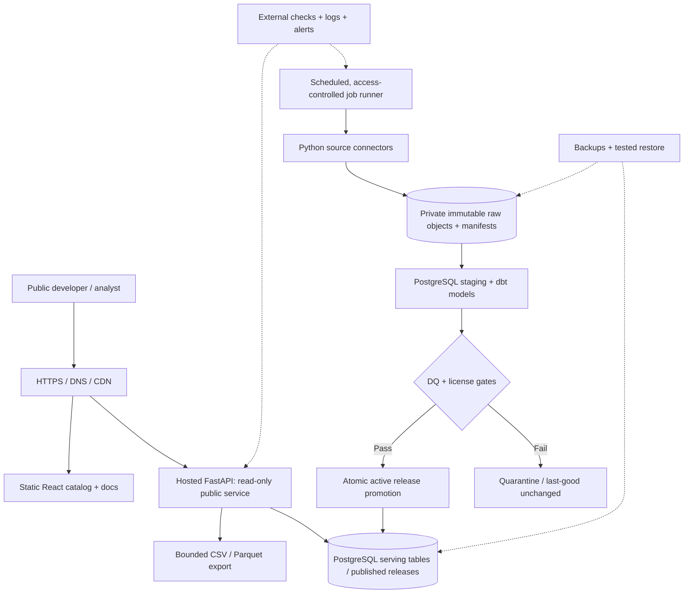

# OpenFactors — ADR Proposal: Zero-Cost Public Hosting

**Document ID:** ADR-HOST-00, recorded as ADR-006 on 2026-10-26. Still not approved. See `docs/decisions/ADR-006-zero-cost-public-hosting.md`.  
**Version:** 0.1 · **Prepared:** 2026-10-26 · **Status:** **PROPOSED — NOT APPROVED**  
**Release target:** OpenFactors Public Beta v0.1 · **Current release decision:** **NO-GO**  
**Budget policy requested by product owner:** USD **$0/month in recurring hosting charges**, with **no unapproved charges or paid overages**.  
**Scope of this ADR:** public serving, operational infrastructure, spending control, staging, monitoring, recovery and release gates. This document does **not** certify any provider as free or approve a production deployment.

> **Important naming conflict:** Earlier design documents call hosting/budget decision **D-05** and refer to **ADR-002** in a separate proposed ADR index. Cursor reports a repository **ADR-005** covering limits. Do **not** overwrite or reuse any identifier. Name this proposal `ADR-HOST-00` until Cursor enumerates the actual `docs/decisions/` ADR index and assigns a unique repository number.

## 1. Decision requested

**Propose** a publicly accessible, **non-commercial, best-effort beta** under a **hard USD $0 monthly spending ceiling**, using only services whose actual account-level free allowances and payment settings are verified before deployment. **Do not approve the hosting topology until a provider comparison and compatibility proof are completed.**

**Preserve** the existing Python/FastAPI read-only API, PostgreSQL data model, immutable raw artifacts, controlled ingestion, dbt transformations, quality-gated immutable releases, release-pinned pagination, and CSV/Parquet exports **unless** an explicit subsequent ADR and contract changes authorize a different serving model.

**Public beta is not permission to waive release gates.** If no provider combination can meet minimum security, data integrity, recoverability and spending requirements for $0, the result is **NO-GO at $0** rather than a silent paid upgrade or degraded, misleading production claim.

## 2. Evidence baseline — what the supplied repository excerpt actually says

The provided `release-checklist.md` states:

- `python -m openfactors.orchestration.accept` reads repository records and reports GO/NO-GO; it does **not** create approvals or update QA evidence.
- **NO-GO** remains intentional.
- Product owner confirmed **five cities on 2026-10-25**. Their exact five names, PSGC IDs and registry evidence are **not included in the supplied checklist**. The older three-location D-01 is superseded in scope **only after** a formally recorded D-01 amendment and contract/fixture reconciliation.
- Holiday years **2018–2026** were transcribed; ERA5 responses **2018-01-01 through 2026-10-25** are stored; weather **2026-10-20 through 2026-10-25** is null in the archive. Null weather must not be fabricated or turned into zero.
- Date-span and rate numbers are unset; ADR-005 rejects invented benchmark numbers.
- Hosted recovery targets and signed load profile are missing; public hosting and paging are not approved.
- Release-blocking QA cases remain **Not run**; residual-risk acceptance, rollback plan, version and signatures are absent.
- Source registry permits redistribution for the stated **non-commercial baseline**; export caps are **100,000 rows / 50 MB**.

Cursor reports OF-001–OF-049 implemented locally; this is **a report, not independent source inspection or QA certification**. Cursor also reports unpublished local changes beyond GitHub `main` commit `639649e`; repository synchronization is pending. The available backlog CSV does not establish actual test pass evidence.

## 3. Scope and non-goals

### In scope

- Public HTTPS access to the React catalog/docs, four existing FastAPI GET endpoints and OpenAPI discovery.
- Read-only serving from approved published release(s), with release-pinned queries and reproducible CSV/Parquet exports.
- Protected ingestion, raw archive, transformations, publication control and scheduled jobs.
- Monitoring, security, backup, restore, operational ownership and release approval under a $0 spending constraint.

### Out of scope

- Guaranteed uptime, 24/7 support, contractual SLO or recovery promises without evidence.
- Paid subscriptions, paid overages, custom domain purchases or credit-card charges without separate approval.
- Replacing FastAPI with static JSON or serverless functions **without** a documented architecture/API migration.
- Expanding redistribution beyond the approved **non-commercial** source terms.
- Declaring five-city coverage verified merely because a checklist says the five-city scope was confirmed.

## 4. Architecture: preferred *evaluation* topology, not a provider commitment

**Hard invariants:**

1. The public API identity is read-only and cannot access raw/staging/control or promote a release.
2. Publication uses the existing quality gate and atomic active pointer. A failed scheduled job must not replace the last-good release.
3. Public serving is HTTPS. Secrets live in approved secret storage, not GitHub, frontend bundles, artifacts or logs.
4. Provider shutdown/suspension or free-tier exhaustion must fail safely, not corrupt the release or generate unexpected charges.
5. If free hosting sleeps or suspends, the catalog must disclose best-effort availability and the last validated publication time; never promise continuous availability.
6. Staging and production must not share production write credentials; a local isolated staging equivalent may be considered **only if** the QA plan and deployment ADR explicitly approve that trade-off.

## 5. Provider selection: verify, don't assume

| Component | Candidate approach | Proof required before approval | Failure / cost risk |
|---|---|---|---|
| Static frontend | Cloudflare Pages, GitHub Pages, or comparable free static host | Current free limits, deploy quotas, HTTPS, custom-domain policy, no paid add-ons | Build/traffic limits, account suspension |
| Python API | Free Python-capable web host **or** compatible free compute allocation | Actual FastAPI process support, cold starts, egress, RAM/CPU, concurrency, persistent process/cron rules, free-tier terms | Sleeping instance, service removal, hard quotas |
| PostgreSQL | Verified free managed PostgreSQL or an eligible self-managed instance | Storage/connection quotas, free-plan pause behavior, backups, networking, PITR availability, roles | Pausing, DB limit, no included backup |
| Immutable raw archive | Free private object storage or encrypted external artifact archive | Capacity, API requests, egress, versioning, private access, retention, backup | Unrecoverable artifacts, download charges |
| Scheduler | GitHub Actions or approved free job runner | Minutes/usage limits, schedule reliability, concurrency lock, secrets, permitted workloads | Delayed runs, missed schedule, quota |
| Monitoring | Free external synthetic checks plus app metrics/logs | Check frequency, notification channel, retention, delivery reliability | False confidence, alert quota |
| Backups | Encrypted backup to **independent** approved location | Tested restoration, data retention, access, export/egress cost | Single-provider correlated failure |
| Domain | Provider-generated HTTPS subdomain | Public URL stability, HTTPS, no purchase required | URL changes, branding |

**No prices or entitlements are asserted here.** Providers and plans change; verify official terms at decision time and capture screenshots/URLs, date, selected plan and account billing configuration. A credit-based “free trial” is **not** an acceptable permanent $0 plan unless a safe expiration and shutdown are explicitly accepted.

### Decision matrix (complete after proof-of-concept)

Score each candidate PASS / FAIL / UNKNOWN, not arbitrary numerical scores:

- FastAPI/OpenAPI compatibility and endpoint behavior
- PostgreSQL connection/permission model
- Immutable raw and release storage, including backup/restore
- Scheduler and secrets separation
- Public HTTPS and rate-limiting controls
- Bounded queries/exports under representative hosted load
- Hard $0 spend enforcement or reliable account-level no-overage safeguards
- Provider acceptable-use and non-commercial redistribution compatibility
- Owner ability to monitor, receive alerts, and recover failures

**Reject** a candidate with FAIL in security, licensing, data integrity or unbounded financial exposure. UNKNOWN is not PASS.

## 6. Cost and billing controls

**Budget ceiling:** $0 recurring infrastructure spend, not “approximately free.” No service may be enabled with paid overages, automatic upgrades, paid storage/egress or a paid backup add-on unless the product owner explicitly authorizes a new budget ADR.

**Preflight:** inventory all providers; inspect whether a payment method is required; verify whether excess usage is blocked, billed or suspends service; disable paid features; configure budget notifications if supported; document where a hard cap is technically impossible. **An alert alone is not a hard cap.** If billing cannot be prevented and exposure is unacceptable, choose another provider or do not deploy.

**Monitor:** storage growth, API/DB usage, bandwidth/egress, build/job minutes, archive retention, export size, and any provider-specific quotas. The existing 100,000-row / 50-MB export caps are **not** proof that the free hosting quotas will suffice.

**Stop condition:** if preserving $0 requires turning off the API, pause public access safely, retain immutable data and display truthful maintenance information. Never incur a charge without authorization.

## 7. API and data contract compatibility

Existing OpenAPI 3.1 describes **four GET endpoints**:

- `GET /api/v1/datasets`
- `GET /api/v1/datasets/daily-external-factors-ph`
- `GET /api/v1/factors/daily`
- `GET /api/v1/exports/daily-external-factors-ph`

`/openapi.json` is the contract-discovery route. Production must serve over HTTPS. Existing required `location_id`, `start_date`, `end_date` and export format, bounded pagination, release pinning, error codes and export behavior remain unchanged unless updated via a separately approved OpenAPI change.

**Do not invent** date-span caps, request rate limits or p95 capacity claims. Run hosted benchmarks with recorded request mix, concurrency, payload sizes, warm/cold start behavior, source dataset size and observed latencies. Only then propose numerical values to the owner for approval under the existing limits ADR.

Preserve the 12-column gold dataset contract and its semantics. The five-city registry must be reconciled with the original three-city D-01, LLD foreign keys, data quality fixtures, catalog, QA cases and OpenAPI descriptions. Null ERA5 weather for 2026-10-20–25 must be disclosed and assessed under the approved coverage and missingness rules, not silently patched.

## 8. Security, legal and data integrity gates

- Confirm source registry terms allow the actual **public, non-commercial** beta, attribution, cached downloads, and intended CSV/Parquet redistribution. If the service will monetize, seek separate rights approval.
- Separate service identities for API read-only, ingestion, transformation, publication and operator restore. Verify negative permissions.
- Use TLS, secret rotation, dependency and container scans, request-size limits, safe error responses, trace IDs and throttling based on measured limits.
- Ensure immutable raw object hashes and release manifests can be restored and validated.
- Test source withdrawal and cache/export invalidation, including old pinned releases. Already downloaded third-party copies cannot be retracted.
- Ensure hosting location/data handling and account access meet applicable obligations. Do not assert a formal compliance certification without assessment.

## 9. Hosted benchmark and recovery evidence plan

### Hosted performance

1. Freeze exact code commit, release candidate, data snapshot and provider plan.
2. Establish representative traffic profile (query ranges, pagination, exports, concurrency, warm/cold cache) and have technical owner approve it.
3. Record p50/p95/p99 latency, 4xx/5xx, cold-start delays, DB pool, CPU/memory, bandwidth and export completion/size.
4. Record provider quotas and headroom. Propose date-span and rate limits **from results**, with approval and OpenAPI/docs updates.
5. Repeat smoke/contract tests after deployment or configuration changes.

### Hosted restore

1. Back up PostgreSQL release/control metadata and immutable raw artifacts to an approved independent location.
2. Restore to isolated environment; validate checksums, row counts, active pointer, read-only permissions and pinned exports.
3. Measure actual time to restore and recoverable data age. Propose RTO/RPO **after** the drill, never before.
4. Record whether free plans support required backup retention and disaster recovery; if not, keep NO-GO or formally reduce the beta's stated reliability expectations **without waiving integrity gates**.

## 10. Monitoring, paging and incident response

- Provide externally reachable uptime checks for catalog, API and a small release-pinned query; track last successful ingestion and publication separately.
- Route incidents to a named primary and backup contact with tested notification delivery. **No paging service exists yet.** Do not claim paging is operational until configured and exercised.
- Apply existing runbooks: upstream failures, DQ quarantine, atomic promotion, release withdrawal, API degradation, export mismatch, scheduler outage, backup restore and secret compromise.
- Disclose the beta's best-effort support hours and recovery limitations publicly; distinguish planned maintenance, free-tier suspension and actual data integrity issues.
- Define operational response responsibilities before exposing a public URL. If notification capability is inadequate for risk, maintain NO-GO.

## 11. Release sequence and decision gates

| Gate | Required evidence | Current state |
|---|---|---|
| G0 — Repository integrity | Review uncommitted changes, exclude secrets/data, commit/push, record SHA | **PENDING** (Cursor reports local changes beyond `639649e`) |
| G1 — Geographic contract | Approved five-city registry, amended D-01, PRD/HLD/LLD/QA/OpenAPI consistency | **PENDING** |
| G2 — Hosting approval | Provider comparison, FastAPI compatibility, $0 spend control, explicit owner approval | **PENDING** |
| G3 — Staging deployment | HTTPS, isolated credentials, contract smoke, DQ/publication and rollback rehearsal | **PENDING** |
| G4 — Hosted performance | Approved load profile, measured p95/limits and documented provider quotas | **PENDING** |
| G5 — Recovery | Tested backup/restore, measured and approved RPO/RTO | **PENDING** |
| G6 — Monitoring | Working alert delivery/paging or explicitly approved support alternative | **PENDING** |
| G7 — QA execution | Release-blocking test case results recorded with actual evidence and defect disposition | **NOT RUN** per checklist |
| G8 — Final approval | Signed residual risks, rollback plan, version, product and technical sign-off | **PENDING** |

**NO-GO if any blocking gate is incomplete.** Do not edit `release-checklist.md` to fabricate results or signatures. The acceptance command is read-only by design.

## 12. Cross-document change-impact matrix

| Existing artifact | Required update or verification | Versioning rule |
|---|---|---|
| PRD | Five-city public beta scope, non-commercial redistribution and best-effort support claims | Minor revision only if current PRD disagrees |
| HLD | Actual approved hosting topology, identity/network/storage boundaries, staging and restore architecture | Revise after provider selection; keep this ADR as proposal until then |
| LLD | Five-city PSGC registry and weather-grid provenance; validate schema and published release invariants | Update metadata/fixtures only as needed; no invented public fields |
| OpenAPI 3.1 | Actual HTTPS server URL; verify deployed four endpoints, caps, errors and pinned pagination | Contract revision only for actual HTTP/semantic changes |
| Engineering Backlog OF-001–049 | Preserve implementation history; open **separate launch readiness tickets** and link evidence | Do not reset completed engineering work or assume all tests passed |
| QA Plan and QA CSV | Execute existing release-blocking cases on hosted environment, add free-tier/cold-start/restore/overage tests | New execution cycle, not duplicated test catalog |
| Operations & Monitoring | Host-specific runbooks, alert delivery, quota exhaustion, backup/restore and provider suspension | Revise once provider and owners are selected |
| D-01 and existing ADRs | Amend 3→5 cities; check ADR-005 and reserve nonconflicting hosting ADR number | Never silently overwrite accepted ADRs |
| Release checklist | Update only with true evidence and authorized approvals | Maintain NO-GO until all gates pass |

## 13. Consequences and alternatives

**Advantages:** Public portfolio value and API accessibility without initial recurring spend; existing implementation retained; incremental operational learning.

**Costs/risks:** sleeping services, unpredictable cold starts, free-tier changes, quotas, provider suspension, limited backups, limited alerting and no uptime guarantee. **These are risks to accept or mitigate, not reasons to mark tests passed.**

**Alternatives:**

1. **Free static-only catalog and prebuilt downloads:** lowest operational cost but not equivalent to existing live FastAPI contract; requires a new architecture/API decision and validation.
2. **Free FastAPI + managed free database + private artifact store:** preferred candidate for proof-of-concept if all compatibility and financial controls pass.
3. **Single free compute instance hosting API/DB:** may simplify hosting but creates a larger single point of failure and restore burden.
4. **Paid small managed deployment:** not authorized under $0; reconsider only with explicit budget ADR.
5. **Remain local:** acceptable fallback if zero-cost public hosting cannot pass security/recovery/release gates.

## 14. Unresolved decisions and approvals

| ID | Open item | Accountable owner | Evidence to close |
|---|---|---|---|
| H-01 | Exact five city names/PSGC/coordinates and D-01 amendment | Product/Data | Approved registry and contract fixture |
| H-02 | Unique repository ADR identifier | Tech owner | ADR index review |
| H-03 | Provider selections and exact free-plan entitlements | Platform/Product | Official terms + deployment POC |
| H-04 | Hard $0 billing protection and service suspension behavior | Product/Platform | Account settings and failure-mode test |
| H-05 | Hosted traffic/load profile and measured limits | Tech/Product | Benchmark report and signed limits ADR |
| H-06 | Backup retention and measured RPO/RTO | Platform/Product | Restore drill and signed recovery policy |
| H-07 | Paging/notifications and support ownership | Product/Platform | Tested alert and escalation record |
| H-08 | Release-blocking QA results | QA/Tech | Actual run evidence in QA execution sheet |
| H-09 | Residual risks, rollback, production version, signatures | Product + Tech | Approved go/no-go record |

## 15. Cursor handoff (copy into an engineering issue)

> Review `docs/decisions/` and identify the next unused ADR ID. Do not overwrite ADR-005. Inventory the implemented repository topology, dependencies, migrations, release scripts, hosting assumptions and existing CI. Compare at least two $0 provider configurations against this ADR's proof gates, with current official plan terms and a hard-spend assessment. Do not select a host, set numeric rate/date limits, claim RPO/RTO, mark QA passed, alter `release-checklist.md` to GO, or invent sign-offs. Report a decision matrix, minimal necessary changes, risks and evidence paths. Preserve the existing FastAPI/OpenAPI contract and five-city data unless a separate approved ADR authorizes changes. Before committing local work, show `git status`, `git diff --stat`, ignored/untracked sensitive artifacts and proposed commit scope for user review.

---
**Status summary:** $0 public beta is the **requested direction**; provider, architecture implementation, reliability, operational readiness and public release are **not yet approved**.
